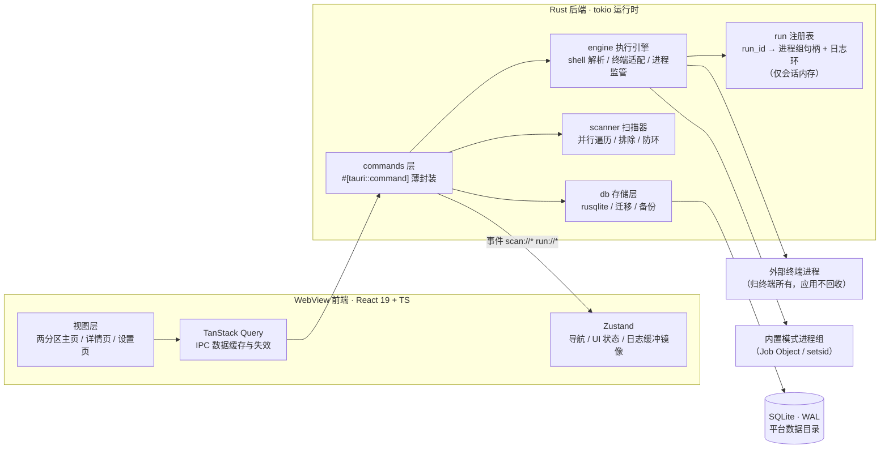
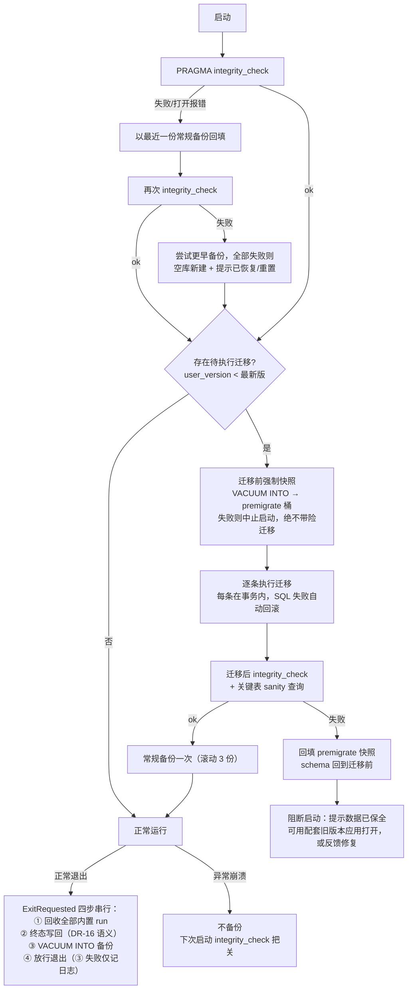
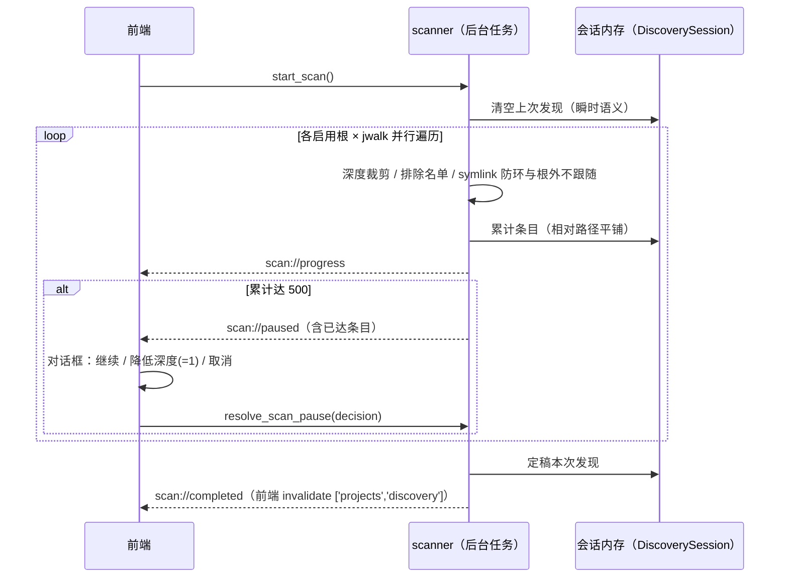
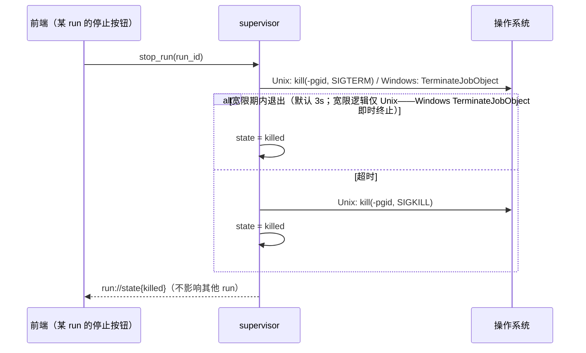
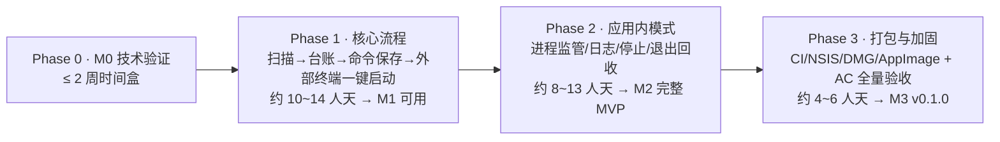

# Squirl 方案设计文档

| 项 | 内容 |
|---|---|
| 产品代号 | **Squirl**（本地项目台账与一键启动中枢） |
| 版本 | v1.4（M0 定版修订）；v1.0 初稿 → v1.1 评审修订 → v1.2 定稿前修补 → v1.3 一致性审查修订（25 项 + DR-16）→ v1.4 M0 定版（适配器矩阵定版 / DR-17 / DR-18 / IPC 契约 v1 冻结标注 / rusqlite 0.40.2） |
| 日期 | 2026-11-02 |
| 上游文档 | [`docs/需求分析文档-汇总版.md`](./需求分析文档-汇总版.md)（需求定稿，附录 A 为最终决策表） |
| 状态 | **已定稿（产品负责人批准）**。不推翻需求汇总版附录 A 的任何既有决策；本文档新增决策以 `DR-nn` 编号记录于第 8 章，DR-1~DR-16 全部确认（DR-12~DR-15 为评审修订新增，DR-16 为一致性审查新增；v1.3 完成 25 项一致性审查修订） |
| 开发授权 | 按《需求分析文档-汇总版》约定：**未经明确授权不进入开发**。本文档仅为设计交付物 |

> 阅读约定：本文不整段复述需求，只做「需求 → 设计」的落实；与需求冲突时以《需求分析文档-汇总版》附录 A 为准。文中标注 ⚖️ 的条目为本次设计新增决策（均已确认，见第 8 章），标注 ⚠️ 的条目为已知风险或需实机验证项。

---

## 目录

1. [文档说明与设计思路](#1-文档说明与设计思路)
2. [背景与设计目标](#2-背景与设计目标)
3. [总体架构](#3-总体架构)
4. [技术选型](#4-技术选型)
5. [详细设计](#5-详细设计)
6. [开发流程与计划](#6-开发流程与计划)
7. [需求缺口与设计建议（G1~G5）](#7-需求缺口与设计建议g1g5默认方案已经评审确认)
8. [决策记录（DR）](#8-决策记录dr)
9. [附录：参考资料](#9-附录参考资料)

---

## 1. 文档说明与设计思路

### 1.1 本文回答什么问题

《需求分析文档-汇总版》回答了「做什么、不做什么、验收什么」；本文回答「**怎么做**」：

- 技术栈的**逐项对比与最终定版**（大方向沿用需求附录 A #19，本文负责复核论证 + 补齐需求文档未定的细项选型）；
- 系统**架构与模块划分**，以及关键链路（扫描、双模式执行、进程回收）的详细设计；
- **IPC 契约**（前后端接口冻结清单）、数据层设计、前端结构设计；
- **开发流程**：如何分期、每个阶段的交付物与退出标准、风险如何控制。

### 1.2 五条设计思路（贯穿全文）

1. **危险链路前置（M0 门禁）**：本产品最大的技术风险不在 CRUD，而在「跨平台唤起外部终端的参数转义」与「应用内进程树的可靠回收」。这两条链路必须在写任何 UI 之前用 2 周时间盒（M0）跑通，失败则重评技术选型——这是需求文档 2.5 节的硬性要求，本文第 6.3 节将其落成可执行清单。
2. **契约先行**：前后端的一切交互收敛到第 5.4 节的 IPC 契约表（invoke 命令 + 事件）。契约在 Phase 1 开工前冻结，之后前后端可并行开发；契约变更是显式评审项。
3. **纵向切片**：不按「先做完全部数据库、再做全部 UI」的水平分层推进，而是按业务切片推进（如「登记一个项目」一次打通 UI → command → DB），每个切片结束时应用始终可运行、可手测。
4. **验收驱动分期**：AC1~AC9 映射到各阶段退出标准（见 6.5），每个阶段以「通过哪些 AC 的哪些子项」定义 Done，而不是以「写完哪些模块」定义。
5. **不污染被管理项目**（架构级不变量）：应用自身的一切写入（SQLite、备份、日志、配置）只发生在平台标准数据目录；对项目目录只读。所有涉及写盘的模块设计都必须通过 AC8（项目根快照前后比对）。

### 1.3 读者与维护

- 读者：产品负责人（决策与验收）、开发者（实现依据，含 AI 结对开发场景——本文的契约表与状态表可直接作为实现约束注入上下文）。
- 维护：设计变更走「修订本文 → 同步第 8 章 DR 表」流程，与需求文档附录 A 的变更流程对齐。

---

## 2. 背景与设计目标

### 2.1 产品边界回顾（一句话）

把散落在多个根目录下的项目登记成一张可搜索的清单，记住每个项目怎么跑，双模式一键启动（外部终端默认 / 应用内可选）；应用内启动的进程，退出时全部收回。**不是**文件搜索器、环境管理器、IDE。

### 2.2 量化设计目标（来自需求 1.5 / 附录 A #15，可实测证伪）

| 指标 | 验收口径 | 设计预算分配 | 对应设计手段 |
|---|---|---|---|
| 安装包体积 | ≤ 10 MB | NSIS 安装包 ≤ 8 MB（Tauri 典型 3~8 MB） | Tauri 2 系统 WebView 复用；前端依赖树控制（见 4.3/4.5） |
| 冷启动到可交互 | ≤ 2 s | 首帧 < 500 ms，可交互 < 1.5 s | 无路由懒加载需求、启动只读 settings + projects 两表、日志等重资源按需初始化 |
| 空闲内存 | ≤ 120 MB | WebView2/WKWebView 空载约 60~100 MB，应用自身预留 ≤ 20 MB | 日志环形缓冲（**2MB 字节硬顶**、5000 行软约束，前端镜像按 seq 同步裁剪）、发现区瞬时数据不冗余复制 |
| 安装后磁盘 | ≤ 30 MB | 程序 ≤ 10 MB + 数据目录预留 | 备份滚动 3 份、应用日志滚动截断 |
| 扫描性能 | 500 项 < 1 s，不阻塞 UI | 单线程 walk 500 目录约 50~200 ms，余量充足 | 并行遍历 + 后台任务 + 事件推送（5.2） |
| 检索性能 | 100 项目、≤3 字符、< 200 ms | SQL LIKE 全表扫描 100 行 < 5 ms，余量一个数量级 | 后端 SQL 查询 + 前端 150 ms debounce（5.5.4） |

### 2.3 非目标（继承需求 1.4，设计上体现为）

- 不引入任何语言运行时管理、不做文件监听（P2）、不做交互式终端（P2 xterm）、不做多机同步（P3）；
- 前端不引入状态机库/表单引擎等重依赖——MVP 交互复杂度不需要。

---

## 3. 总体架构

### 3.1 进程模型与分层

Tauri 2 双进程形态：**WebView 前端进程**（React 渲染）+ **Rust 主进程**（业务核心）。IPC 仅两条通道：`invoke`（命令，请求-响应）与 `emit`（事件，后端推送）。



职责边界（继承需求 1.6「分工」）：**前端只做交互与渲染，一切耗时操作（扫描、进程、SQL、路径规范化）在 Rust。** 前端甚至不做搜索过滤（已登记区搜索走后端 SQL），只做发现区的本地名称过滤（需求 F2 明确该项不入全局搜索）。

### 3.2 Rust 模块划分

```
src-tauri/src/
├─ main.rs / lib.rs        # Tauri Builder 装配：插件、状态、单实例回调、退出钩子
├─ commands/               # IPC 层：参数校验 → 调用领域层 → 统一错误映射（薄，禁止业务逻辑）
│  ├─ settings.rs  roots.rs  scan.rs  projects.rs  commands.rs  run.rs
├─ db/
│  ├─ mod.rs               # 连接管理（单连接 Mutex 模型，DR-6）、WAL 配置
│  ├─ migrate.rs           # rusqlite_migration 迁移链
│  ├─ backup.rs            # VACUUM INTO 快照、integrity_check、损坏恢复
│  └─ repo/                # settings / roots / projects / commands 各表仓储
├─ scanner/
│  ├─ walker.rs            # jwalk 并行遍历、排除名单、深度、防环
│  ├─ flags.rs             # 标志文件探测（package.json 等）
│  └─ session.rs           # 「本次发现」会话内存 + 500 条暂停协议
├─ engine/
│  ├─ shell.rs             # Shell 层：解析优先级、支持列表、路径定位
│  ├─ emulator.rs          # 模拟器层：探测与选择
│  ├─ adapter.rs           # TerminalAdapter trait + 各平台适配器（见 5.3.2）
│  ├─ quoting.rs           # 逐 shell 转义规则（纯函数，重点单测对象）
│  ├─ supervisor.rs        # 内置模式进程监管：run 注册表、日志管道、状态机
│  └─ reap.rs              # 手动停止 / 退出回收 / 崩溃兜底三条路径
├─ models/                 # serde 结构体（IPC DTO 与 DB 行复用字段定义）
├─ error.rs                # AppError（thiserror）→ IPC 错误 JSON
└─ paths.rs                # 数据目录、路径规范化（dunce + 大小写折叠）、归属前缀计算
```

前端模块划分见 5.5。

### 3.3 架构不变量（违反即评审驳回）

| # | 不变量 | 依据 |
|---|---|---|
| INV-1 | 应用对被管理项目目录**只读**；一切自身写入限于平台数据目录 | AC8 |
| INV-2 | **外部模式的进程绝不进入 Job Object / 进程组管理**——否则退出回收会误杀用户终端 | 需求 F6 与附录 A #9 的「两条路径不得混同」，见 5.3.6 |
| INV-3 | 内置模式的每次启动都分配 `run_id`（UUID），日志、进程句柄、停止操作一律按 `run_id` 归属 | 附录 A #6 |
| INV-4 | 所有路径入库前必须经 `paths::normalize`（绝对路径 + 原生分隔符 + 平台大小写折叠 + `\\?\` 策略） | 附录 A #14 |
| INV-5 | IPC 错误一律是结构化 `{code, message, detail?, data?}`，禁止裸字符串错误穿透到前端 | 5.4 / 5.8 |
| INV-6 | 命令原文（`command_line`）作为**事实记录**存储与直传，后端不做二次 shell 解析（转义只发生在适配器模板层） | 附录 A #8 |

---

## 4. 技术选型

> 选型方法：需求附录 A 已定案的项做「复核论证」（用 2026-11 的实时数据验证仍为最优，防止决策过期）；需求未定的项做「对比 + 推荐 + 裁决状态」。版本号为 2026-11-01 经 npm / crates.io 实测的最新稳定版。

### 4.1 桌面框架：Tauri 2（复核结论：维持）

| 维度 | Tauri 2.12（选定） | Electron | Wails / Neutralino | Qt / Flutter Desktop |
|---|---|---|---|---|
| Hello World 安装包 | ~3~12 MB | ~85~200 MB | ~2~10 MB | Qt ~30 MB+ / Flutter ~20 MB+ |
| 空闲内存 | ~40~80 MB | ~150~400 MB | 与 Tauri 相近 | 中等 |
| 后端语言 | Rust（与进程管理需求天然匹配） | Node.js | Go | C++ / Dart |
| 渲染一致性 | 依赖系统 WebView（三端三种内核）⚠️ | 自带 Chromium，最一致 | 同 Tauri | 自绘引擎，一致 |
| 2026 生态成熟度 | 2.x 稳定线，官方插件齐全 | 最成熟 | 中等 | 成熟但与本项目技术栈不符 |

**结论**：验收口径（安装包 ≤10MB、空闲内存 ≤120MB）**只有 Tauri 能达**——Electron 空载内存即超出预算 1~3 倍，直接出局；本产品核心是进程管理，Rust 后端（Job Object / setsid / prctl 一等公民）是决定性加分项。维持附录 A #19 决策。

⚖️ **DR-9（新增）**：锁定 **Tauri 2.12.x**。Tauri 3 目前仅 alpha、无稳定时间表，**不采纳**；列入观察项——待 3.0 stable 发布且生态插件跟进 3 个月后另立升级评审，MVP 期间不投入。

### 4.2 前端框架与语言

**React 19（维持）**：shadcn/ui 生态以 React 为一等公民；Vue/Svelte 在本项目的决定性差异为零（无复杂状态拓扑），换框架无收益。React 19.3 稳定线。

**TypeScript 7（⚖️ DR-5，新增决策）**：TS 7.0.2 为 **Go 原生编译器**，类型检查约 10 倍速，2026-11 起为 `latest`。对单人项目是纯增益（大项目才有兼容性长尾风险）。**回退预案**：若个别工具链（ESLint 插件等）出现不兼容，语法完全兼容 TS 5.x 线，降级成本低。

**构建：Vite 8（维持，版本升级）**：需求定案 Vite，当前稳定 8.3.x（Environment API 已稳定）。对比 Rspack/Turbopack：均为优秀工具，但 Tauri 官方模板与社区文档以 Vite 为默认，本产品前端体量（≤15 个组件）下三者无可感知差异，**选生态默认即最小风险**。

### 4.3 UI 层（维持）：Tailwind CSS 4 + shadcn/ui

shadcn/ui 是「源码拷贝」型组件库：零运行时依赖、组件进包体积可控、可深度定制——契合 ≤10MB 包体与桌面工具的气质。对比 antd/MUI：二者运行时体积与主题定制成本对本产品是负资产。辅助库：

| 需求 | 选型 | 说明 |
|---|---|---|
| 日志面板 5000 行渲染 | `@tanstack/react-virtual` 3.14 | 虚拟滚动，日志 DOM 节点恒定 |
| ANSI 渲染 | `anser` 2.3.5 | 纯函数 ANSI→React spans，约 5KB；不用 xterm.js（那是 P2 交互式终端的方案，MVP 只读日志不值得背 200KB+） |
| 图标 | `lucide-react` | shadcn/ui 默认搭配 |

### 4.4 前端数据与状态层（⚖️ DR-3，用户已裁决）

**TanStack Query 5 + Zustand 5**，职责切分：

| 类别 | 归属 | 示例 |
|---|---|---|
| 后端事实数据（可失效、可重取） | TanStack Query | projects / roots / settings / discovery / run 列表 |
| 纯 UI 状态 | Zustand | 当前视图、面板折叠、对话框 |
| 高频事件流（日志分批推送） | **绕过 Query**，直达 Zustand `logStore` | 30ms 一批的日志若进 Query 缓存会产生无意义失效风暴，故日志面板直接订阅事件写入 store，挂载时用 `get_run_log` 补快照 |

对比项：Redux Toolkit（样板代码对单人项目过重）、自研 hooks+Context（缓存失效/竞态全手写，扫描进度+运行状态+日志三类推送并存时极易出错）。无路由器：全应用仅 3 个视图（主页/详情/设置），用 Zustand `navStore` 切换即可，避免引入 react-router 的 URL 语义（桌面窗口无浏览器前进后退），⚖️ **DR-4**。

### 4.5 存储层（⚖️ DR-2，用户已裁决）：rusqlite

**rusqlite 0.41（bundled）+ rusqlite_migration 2.6**。对比 sqlx：

| 维度 | rusqlite（选定） | sqlx |
|---|---|---|
| API 模型 | 同步 | 异步 + 连接池 |
| 本地单用户 SQLite 适配 | 池与异步是负资产，不需要 | — |
| Backup API / VACUUM INTO | 直接可用（需求附录 A #12 依赖） | 需绕行 raw SQL |
| 编译期 SQL 校验 | 无（用集成测试覆盖） | 有，但需离线 `.sqlx` 缓存，增加 CI 复杂度 |
| SQLite 驱动成熟度 | 事实标准 | 相对年轻 |

**连接模型（⚖️ DR-6）**：`Arc<Mutex<Connection>>` **单连接** + WAL。理由：本产品数据量（≤500 项目）与写并发（单人操作）下，连接池毫无必要；WAL 在本设计中的价值是**快照读一致性**（5.1.2 备份安全论证 DR-14 的基础）——单连接下读写本就经 Mutex 串行，「读不阻塞写」的并行能力为未来引入第二连接预留；rusqlite `Connection` 非 `Sync`，Mutex 包装是标准做法。所有 DB 调用经 `tokio::task::spawn_blocking` 或专用阻塞线程执行，不阻塞 IPC 线程。**迁移**：`rusqlite_migration` 基于 `PRAGMA user_version`，对应需求的 `schema_version` 语义。**bundled 特性**必开：三平台自带一致版本 SQLite，WAL 行为可复现，安装包仅增约 1MB。

### 4.6 Rust 依赖清单（版本实测于 2026-11-01）

| crate | 版本 | 用途 |
|---|---|---|
| tauri / tauri-build | 2.12.x | 框架 |
| tauri-plugin-single-instance | 2.5 | 单实例，二次启动唤起窗口 |
| tauri-plugin-log | 2.10 | 应用自身日志（写数据目录，非命令日志） |
| tauri-plugin-opener | 2.7 | P2 Git remote URL 直达预留；MVP 仅注册 |
| rusqlite / rusqlite_migration | 0.40 / 2.6 | 存储（bundled）；**M0 实测定版 0.40.2**——rusqlite_migration 2.6.0 依赖 rusqlite ^0.40，0.41 无法共存（ADR-5） |
| tokio / tokio-util | 1.54 / 0.7 | 异步运行时、CancellationToken（扫描取消） |
| serde / serde_json | 1.0 | DTO |
| uuid | 1.29 | 主键与 run_id（v7，趋势排序友好） |
| thiserror | 2.0 | 错误定义 |
| tracing / tracing-subscriber | 0.1 | 结构化日志 |
| jwalk | 0.9 | 并行目录遍历（见 5.2，对比 walkdir 串行版） |
| dunce | 1.0 | 路径规范化：canonicalize 但避免无谓 `\\?\` 前缀 |
| windows | 0.62 | Job Object / CREATE_NEW_CONSOLE 等 Win32 API |
| libc / nix | 0.2 / 0.31 | Unix 进程组 kill、prctl(PDEATHSIG) |

前端版本基线：React 19.3 / TS 7.0 / Vite 8.3 / Tailwind 4.3 / TanStack Query 5.105 / Zustand 5.0 / react-i18next 17.1 / vitest 5.0 / Node 24 LTS。**工程规范**：脚手架日用 `Cargo.toml` + `package.json` 把上表 pin 成精确版本，锁文件入库；次版本升级走独立 PR。

### 4.7 工具链（⚖️ DR-5）

| 用途 | 选型 | 对比结论 |
|---|---|---|
| 前端 Lint + Format | **Biome 2.x**（一个工具二合一，Rust 实现，秒级） | 对比 ESLint+Prettier 双工具链：配置面减半、速度差一个量级；单人项目生态插件需求少。若遇到 React Hooks 规则缺口再回退 ESLint |
| Rust | rustfmt + clippy（官方，`-D warnings` 入 CI） | 无争议 |
| 前端测试 | vitest 5 + Testing Library | 与 Vite 同源零配置 |
| Rust 测试 | cargo test（单测 + `#[cfg(target_os)]` 集成测试） | 进程/转义类测试天然平台绑定，见 5.3.7 |
| 提交规范 | Conventional Commits（仓库现有 `docs:/chore:` 风格延续） | — |

### 4.8 选型复核结论汇总

- **维持**：Tauri 2、React、Vite、Tailwind + shadcn/ui、SQLite(WAL)、GitHub Releases 分发。
- **版本升级**：Vite 8、TS 7、Tailwind 4、React 19（需求成文时未 pin 具体版本号，本文按 2026-11 实测定版）。
- **新增定案**：rusqlite（DR-2）、TanStack Query + Zustand（DR-3）、jwalk、Biome、anser、无路由（DR-4）。
- **⚠️ 平台事实（选型内风险，M0 覆盖）**：三端 WebView 内核不同（WebView2 / WKWebView / webkitgtk），CSS 行为可能有差异 → 组件保持 shadcn 基线、避免花哨 CSS；Linux webkitgtk 偏老且内存偏高，而 Linux 产物本就「未实机验证」，风险已为需求所接受。

---

## 5. 详细设计

### 5.1 数据层设计

#### 5.1.1 Schema（v1，与需求 2.3 逐字段一致）

```sql
PRAGMA journal_mode = WAL;
-- 迁移框架使用 PRAGMA user_version 记录 schema_version

CREATE TABLE settings (
  id INTEGER PRIMARY KEY CHECK (id = 1),
  default_mode TEXT NOT NULL DEFAULT 'external',      -- external | builtin
  default_emulator TEXT,                              -- NULL = 自动探测
  default_shell TEXT,                                 -- NULL = 自动解析
  load_shell_profile INTEGER NOT NULL DEFAULT 1,
  scan_depth INTEGER NOT NULL DEFAULT 1 CHECK (scan_depth BETWEEN 1 AND 10)
);

CREATE TABLE roots (
  id TEXT PRIMARY KEY,                                -- UUID v7
  path TEXT NOT NULL,                                 -- 原生分隔符绝对路径
  path_normalized TEXT NOT NULL UNIQUE,
  enabled INTEGER NOT NULL DEFAULT 1
);

CREATE TABLE projects (
  id TEXT PRIMARY KEY,
  path TEXT NOT NULL,
  path_normalized TEXT NOT NULL UNIQUE,
  name TEXT NOT NULL,
  note TEXT NOT NULL DEFAULT '',
  exec_mode TEXT,  exec_emulator TEXT,  exec_shell TEXT,  -- execution_override，NULL=跟随全局
  created_at TEXT NOT NULL,                           -- RFC3339 / UTC
  last_run_at TEXT,
  run_count INTEGER NOT NULL DEFAULT 0
);

CREATE TABLE commands (
  id TEXT PRIMARY KEY,
  project_id TEXT NOT NULL REFERENCES projects(id) ON DELETE CASCADE,
  name TEXT NOT NULL,
  command_line TEXT NOT NULL,
  cwd TEXT,                                           -- NULL = 项目根
  last_run_at TEXT,
  last_exit_code INTEGER                              -- 仅内置模式写入；外部模式恒 NULL
);
CREATE INDEX idx_commands_project ON commands(project_id);
```

说明：`execution_override { mode?, emulator?, shell? }` 以三个可空列落地（三值独立「跟随全局或指定」，附录 A #3）；`ON DELETE CASCADE` 支撑已采纳缺口 G1（项目删除）。

#### 5.1.2 备份、迁移与恢复（需求附录 A #12 + DR-13/DR-14）



- **两套独立滚动快照桶（DR-13）**：常规桶 `squirl.db.bak-1..3`（启动迁移成功后 + 正常退出时各一份）与**迁移前桶 `squirl.db.premigrate-1..2`**——仅当存在待执行迁移（`user_version` < 最新版）时，在执行迁移动作**之前**强制生成；快照生成失败则中止启动，绝不带险迁移。两桶独立轮换，迁移前快照不会被日常备份淘汰。
- 备份命令：`VACUUM INTO`（一致性快照，满足「禁止直接复制 db 文件」）。
- **迁移失败的双层防御**：rusqlite_migration 每条迁移运行在事务内，SQL 层失败自动回滚、`user_version` 不动——防「迁一半」；premigrate 快照防的是「迁移提交成功但语义错误」（SQL 回滚救不了的场景）。恢复动作 = 回填 premigrate 快照（schema 回到迁移前）+ **阻断启动**，并明示降级路径：数据无损，可用配套的旧版本应用打开，或待修复后重试。
- **正常退出时序（DR-14）**：`ExitRequested` → ① 回收全部内置 run → ② 各 run 终态写回（按 DR-16：`exited/failed` 写 `last_exit_code`，`killed` 不写；`last_run_at` / `run_count` 均更新）→ ③ `VACUUM INTO` 备份 → ④ 放行退出；③ 失败仅记应用日志、不阻断退出。**安全性论证**：单连接模型（DR-6）下所有读写经同一 `Mutex` 互斥，备份与写回物理上不可能并发；即便未来引入第二连接，WAL 快照读也保证 `VACUUM INTO` 读到一致快照且不阻塞写。四步串行约束的是**语义**——保证备份内容包含最终写回结果——而不仅仅是安全性。
- 备份恢复提示走 INV-5 结构化事件 → 前端 toast（对应 AC9「给出提示」）。

#### 5.1.3 路径规范化（`paths::normalize`，INV-4）

| 平台 | 规则 |
|---|---|
| Windows | `dunce::canonicalize`（能短则短，避免无谓 `\\?\`）；解析 UNC/盘符；折叠小写（`to_lowercase`，含 Unicode，覆盖中文路径）；长度 > 260 的 fs 访问加 `\\?\` 前缀 |
| macOS | canonicalize + 折叠小写（APFS 默认大小写不敏感，与需求一致） |
| Linux | canonicalize + 保留大小写 |

⚠️ 边界事实：macOS 文件系统 NFD 分解与 Windows NFC 的 Unicode 差异理论上影响小写折叠后的字符串等价判断；MVP 按「同机自登记」场景处理（登记路径与扫描路径同源），不做 Unicode 正规化，列入已知限制注释。

#### 5.1.4 归属派生（不落库，需求附录 A #21）

```
attribution(path_norm, roots_norm) -> Option<root_id>
  = path_norm 的所有根前缀候选中，取最长者；
  前缀匹配必须落在分隔符边界：root_norm == p || p.starts_with(root_norm + SEP)
  （防 D:\GitHub 误吞 D:\GitHub2）；无命中 → None（无归属）
```

每次 `list_projects` 时在 Rust 侧内存计算（≤500 项目 × ≤10 根，微秒级），根目录增删后无需回写。

#### 5.1.5 数据导出与换机迁移（P3 前瞻契约；MVP 保证不封死，DR-15）

需求将「导入导出」「跨设备同步」列为 P3（P3 #16、#20），MVP 不实现导出功能；但本轮评审明确：**v1 数据模型必须保证「换机」场景（导出 → 目标机导入 → 路径重映射）不因 schema 设计而封死**。落点：

- **格式契约（P3 实现时冻结，此处预留）**：单一版本化 JSON——`{ format: "squirl.export", format_version, schema_version, exported_at, settings, roots[], projects[], commands[] }`。四表均为平铺行、无嵌套归属结构；`settings` 单行表（`CHECK(id=1)`）序列化即单对象，**单行设计对导出是有利的**（不存在多行配置的归并歧义）。
- **路径重映射语义**：导出物同时携带原始 `path` 与 `path_normalized`；导入端按「根目录锚点映射表」（旧根 → 新根，用户逐条确认）做前缀重写，随后**在目标机重新执行 `paths::normalize`** 重算 `path_normalized`，唯一约束在重算后校验（冲突条目跳过并列出）；无锚点命中的条目按「无归属 + 路径失效」导入——条目保留、可重新定位，恰好复用 F2 既有机制，零新增概念。
- **MVP 具体保证（均已满足）**：① `path` 与 `path_normalized` 双列分离（5.1.1）；② 主键全部 UUID、无自增依赖；③ repo 层不依赖插入顺序；④ P3 #16「根目录别名 + Git Remote URL 双锚点」与本节前缀重映射同构，同步插件可复用同一导入管线。
- 若需将「换机导出/导入」提前到 MVP/Phase 3：成本约 1 人天（`export_data` / `import_data` 两条命令 + 文件选择器），属范围变更，须产品负责人另行授权。

### 5.2 扫描器设计（F1）

#### 5.2.1 流程与协议



关键实现点：

- **单飞**：扫描进行中再次 `start_scan` 返回 `E_SCAN_IN_PROGRESS`（携带现有进度）；根目录增删/手动刷新都复用同一入口。
- **暂停协议**：walker 循环内每收一批条目检查计数；暂停用 `CancellationToken` + `watch` 通道接收裁决。「降低深度」= 剩余根按深度 1 续扫（已扫部分不回滚）。
- **排除**：按条目名匹配内置名单（`.git`、`node_modules`、`.venv`、`venv`、`__pycache__`、`target`、`dist`、`build`、`.next`、`.idea`、`.vscode` 等），MVP 不可编辑；jwalk `process_read_dir` 中剪枝，**被排除目录整个子树不入队**（AC7 的克制性来源）。
- **符号链接**：`symlink_metadata` 识别；对每个待跟随链接取 canonical 目标——已在 visited 集合则跳过（防环）、落在所有根之外则只列出条目不下降（需求两条硬限制）。
- **标志文件探测**：候选目录上 `exists` 探测 `package.json` / `pyproject.toml` / `Cargo.toml` / `go.mod` / `pom.xml` / `Makefile` / `.git`，命中即带 `flags` 字段（用于高亮；不做过滤——需求「识别是猜测，记录是事实」）。
- **「本次发现」存于会话内存**（`Arc<RwLock<Vec<DiscoveryEntry>>>`），不入库、重启即空；登记动作 `register_project(path)` 才落库。
- 并行度：jwalk 默认并行 + 单根内顺序保证无需排序需求（平铺展示不要求顺序），500 项预算 < 1s 实测必然富余。

### 5.3 执行引擎设计（F3/F4/F5——全项目技术核心）

#### 5.3.1 两层配置解析

**Shell 层**（两模式共用，`engine::shell`）：

| 优先级 | Windows | macOS/Linux |
|---|---|---|
| 1 | `pwsh`（PATH 定位，7+） | `$SHELL`，basename 在支持列表 {bash, zsh} |
| 2 | `powershell.exe`（解析到具体路径，UI 警告 `&&` 不可用） | `zsh` → `bash`（逐个探测存在性） |
| 3 | `cmd.exe`（`%COMSPEC%`） | — |
| 兜底 | fish/nushell/csh 探测到 → 回退默认链 + 设置页提示（附录 A #22） | 同左 |

支持列表与逐 shell 参数（需求 F4 表，实现为常量表 + 单测覆盖）：

| shell | 内置模式 | 外部模式 | profile |
|---|---|---|---|
| pwsh 7+ | `-Login -NoLogo -Command` | 同左（经适配器包装） | 默认加载 |
| powershell.exe 5.1 | `-NoLogo -Command` | 同左 | 默认加载 |
| cmd | `/c` | `/k` | 不处理 AutoRun |
| bash / zsh | `-lic`（`-c` 后接命令） | 同左 | 登录+交互加载 |

**模拟器层**（仅外部模式，`engine::emulator`）：

| 平台 | 探测顺序 | 探测手段 | 兜底 |
|---|---|---|---|
| Windows | Windows Terminal | `wt.exe` 存在于 `%LOCALAPPDATA%\Microsoft\WindowsApps` 或 PATH（⚠️ App Execution Aliases 假阳性风险，M0 验证） | 控制台宿主（`CREATE_NEW_CONSOLE` 直接唤起 shell，Win11 下系统本身即 WT） |
| macOS | Terminal（必在） → iTerm2 | `/Applications/iTerm.app` 存在性 | Terminal.app |
| Linux | gnome-terminal / konsole / alacritty / kitty / xterm | PATH 逐个探测 | 探测失败报 `E_NO_EMULATOR`，用户手动指定 |

全局默认 + 项目覆盖 `execution_override` 的合并语义：`Option<T>` 三值（None=跟随全局），合并函数纯化可测。

#### 5.3.2 终端适配器抽象（`engine::adapter`）

```rust
trait TerminalAdapter {
    fn id(&self) -> &'static str;                       // 如 "wt+pwsh"、"conhost+cmd"
    fn build_launch(&self, job: &LaunchJob) -> Result<LaunchPlan>;
    // LaunchJob { shell: ShellSpec, command_line: String, cwd: PathBuf, keep_open: bool }
    // LaunchPlan { program, args, env, cwd, creation_flags/platform_extras }
}
```

组合矩阵（MVP 必须覆盖需求 F4 列举的组合；每格 = 「唤起模板 + 直传 + 转义 + 保持打开」四件套；**M0 已实机定版**，证据见 `docs/进度与验证记录.md` Spike A）：

| 平台 | 模拟器 × shell | 唤起要点（M0 定版） |
|---|---|---|
| Windows | WT × pwsh/cmd/GitBash | `wt -d <cwd> -- <shell 原参数>`（`--` 分隔符实机验证通过；wt.exe 句柄即退，shell 短持） |
| Windows | conhost × pwsh | `-NoLogo -NoExit -File <脚本>`（pwsh7 加 `-Login`）；脚本 = marker + 命令原文，UTF-8 BOM，写数据目录 tmp，启动清扫（`exit 1` 实机不闪退） |
| Windows | conhost × cmd | `cmd /k <原文>`（raw 传递）；已知限制：命令含字面 `exit` 时 cmd 连 `/k` 一起结束（cmd 内建语义） |
| Windows | conhost × GitBash | `bash -lic "printf <marker>; ( <原文> ); exec bash"`（子壳形态，`exit 1` 只杀子壳，实机验证） |
| macOS | Terminal × zsh/bash | `osascript -e 'tell app "Terminal" to do script "cd <cwd> && <wrapped>"'`（双层转义 ⚠️；tab 本身即交互 shell） |
| macOS | iTerm2 × zsh/bash | AppleScript 建新 session `write text`（⚠️ 同上） |
| Linux | gnome-terminal / konsole × bash/zsh | `<emu> --workdir/-d <cwd> -- bash -lic "…( <原文> ); exec bash"`（macOS/Linux 代码级实现 + 转义单测，未实机验证） |

- **直传原则**（INV-6）：`command_line` 原文不经二次 shell 解析——适配器只负责把它安全地「递进」目标 shell（包裹为该 shell 的 `-Command` / `-c` 参数），包裹层转义由 `engine::quoting` 逐 shell 纯函数实现并单测。
- **保持打开（M0 实测定版）**：cmd 用 `/k`；pwsh 用 `-NoExit -File`（脚本文件形式——`-NoExit -Command` 会被命令中的 `exit` 关键字杀掉，实机 T1/T2/T7 验证，见 DR-18）；bash/zsh 用 `( <命令> ); exec <shell>` 子壳形态。验收「故意 exit 1 后窗口不闪退」：pwsh/bash/WT 实机通过；cmd 以失败命令验证（字面 `exit` 为已知限制）。
- **外部唤起机制（M0 定版，DR-17）**：Windows 用 `CreateProcessW` 直启（**不设 `STARTF_USESTDHANDLES`**）——`std::process::Command` 总是传父进程 stdio，`CREATE_NEW_CONSOLE` 的新控制台不接管 stdio，keep-open 交互 shell 会从父 stdin 读到 EOF 立即退出（探针实机证据）；`lpApplicationName` 不做 PATH 搜索，裸名经 `locate_on_path` 兜底。cmd 参数 raw 拼接（cmd 不理解 MSVCRT `\"`）。
- **profile 噪音分离**：适配器在命令前注入该 shell 方言的 marker 输出（如 bash 方言 `printf '\n──── squirl command output ────\n'`），内置模式日志面板把 marker 之前的内容折叠为「profile 输出」可展开区（需求「分隔线」的实现）。

#### 5.3.3 内置模式：进程监管（`engine::supervisor`）

**run 注册表**（会话内存，INV-3）：

```rust
struct RunHandle {
    run_id: Uuid, command_id: Option<Uuid>,   // None = 临时命令
    state: RunState,                          // idle/starting/running/exited(code)/failed/killed
    command_line: String,                     // 命令原文（事实记录）
    plan: LaunchPlan,                         // 适配器解析后的最终执行参数（5.3.2）
    shell: ShellSpec, cwd: PathBuf,           // 实际生效配置与工作目录
                                              // （模拟器层仅外部模式使用；外部模式无 RunHandle，见 5.3.4）
    child: tokio::process::Child,
    job: JobGuard,                            // Windows: Job Object 句柄；Unix: pgid（ RAII：Drop 时兜底收树 ）
    log_buf: Arc<RwLock<RingBuffer>>,         // 2MB 字节硬顶 + 5000 行软约束（截断按字节，前端按 trimmed_lines 对齐裁剪）
    started_at: Instant, last_output: Instant, ended_at: Option<Instant>
    // last_output 兼作疑似等待输入启发式（DR-8）
}
// 全局: Arc<Mutex<HashMap<Uuid, RunHandle>>>；Tauri State 注入
```

**启动时序**：解析两层配置 → 工作目录（命令 cwd 默认项目根，两模式统一，附录 A #7）→ 重复启动检查（同 `command_id` 已有 running 实例 → 默认拒绝 `E_ALREADY_RUNNING{run_id}`，前端给「再启动一个」入口 → `force_new` 重入）→ 组装 `LaunchPlan`（登录 shell + marker + 命令）→ spawn（**独立进程组**：Unix `process_group(0)`；Windows 入 Job Object）→ `starting → running` 事件。

**Launch record（DR-12）**：每次启动（内置与外部模式一致）在 spawn 前以 `tracing::info` 写一条结构化启动记录——`run_id、command_id、mode、adapter_id、实际生效的 shell 路径与模拟器、cwd、program、args（经适配器转义后的最终参数）`；到达终态时补写 `ended_at` 与 `exit_code`。**定位澄清**：需求「运行实例仅会话内存、不落库」约束的是台账 SQLite schema，应用诊断日志（数据目录 `logs/`，见 5.8）不在此列——「外部模式点了没反应」类问题凭 launch record 即可回溯应用实际执行了什么；启动失败时 `E_LAUNCH_FAILED` 的 `detail` 携带同一记录，UI 错误横幅可直接展示。

**日志管道**：stdout/stderr 两读任务 → `mpsc` 汇聚（带流来源标记，stdout/stderr 交叉顺序尽力而为、文档注明）→ 聚合任务 **30ms 或 64KB 先到先发**批量 `emit` → 同时写入环形缓冲。**环形缓冲统一口径（DR-7）**：字节上限 **2MB 为硬顶，5000 行为软约束**——超限时从头部按字节丢弃最早内容（一次可能丢多行）；截断发生后，后端在后续事件中携带**累计截断行数 `trimmed_lines`**（环形缓冲头行 seq = `trimmed_lines + 1`），前端据此丢弃本地镜像中 seq 更早的行，保证双端视图一致。行级 seq 由前端按批次连续编号维护（后端保证批次有序、无缺口），后端不逐行携带。UTF-8 无损解码（有损兜底 `lossy`），换行归一 CRLF→LF；ANSI 原文透传，由前端 anser 渲染（DR-7）。

**状态机**（六状态，需求 4.3 为准）+ UI 事件：每次变迁 `emit run://state`。退出码 0 → `exited`；非 0 → `failed`（5 秒内 UI 呈现，AC5——事件即时到达天然满足）。终态写回语义（DR-16）：`exited/failed` 写 `commands.last_run_at + last_exit_code`；`killed` **不写 `last_exit_code`（保留上次值）**、仅更新 `last_run_at`；`projects.run_count` **双模式均累计**（外部模式启动成功即 +1，经 launch record 计数）。

**无交互与疑似等待输入**（⚖️ DR-8）：MVP 不提供 stdin（管道直接关闭，交互命令读到 EOF 多数立即报错退出）。启发式：`running` 且距今 30s 无任何输出 → `run://input-suspected` 事件 → UI 提示「命令可能在等待输入（MVP 不支持交互）」+ 强制停止按钮。启发式可能误报（长静默构建），**只提示不干预**。阈值 30s 为初值，**待 S7 实测校准**（长静默构建场景，如大型依赖安装 / Rust 全量构建的无输出窗口）。

#### 5.3.4 外部模式：唤起（fire-and-forget）

`LaunchPlan` 执行后：**不创建 Job Object、不跟踪进程树**（INV-2）；仅短持启动器句柄用于判断「窗口唤起是否失败」（如 wt.exe 秒退报错 → `E_LAUNCH_FAILED`）；写 `last_run_at` 后即放手。唤起前写入 launch record（DR-12，见 5.3.3）；唤起失败时错误 `detail` 携带该记录，前端可在错误横幅展示「应用实际执行的命令」。AC3 口径：点击到终端窗口出现 ≤ 2s。

#### 5.3.5 手动停止（内置模式，单命令）



Windows 侧 Job Object 参数：`JOB_OBJECT_LIMIT_KILL_ON_JOB_CLOSE`；**不开** breakaway，子进程默认留在作业内（含 npm 派生的孙进程）；`JobGuard` RAII——句柄 Drop 即内核收树。

#### 5.3.6 退出回收与崩溃兜底（F6，两条路径不得混同）

| 路径 | 机制 | 覆盖范围 | 验收 |
|---|---|---|---|
| ① 正常退出（关窗=退出，MVP 无托盘） | `RunEvent::ExitRequested` 钩子四步串行（DR-14）：① 遍历注册表逐一 `stop_run`（并行、每 run 3s 宽限上限）→ ② 各 run 终态写回 DB → ③ `VACUUM INTO` 备份 → ④ 放行退出；③ 失败仅记日志 | 含孙进程整组（Job Object / kill(-pgid)） | **AC4 唯一验收路径**（npm run dev 孙进程重点 10/10） |
| ② 异常崩溃兜底 | Windows：KILL_ON_JOB_CLOSE 内核保证；Linux：`PR_SET_PDEATHSIG`（仅直接子）；macOS：无机制 | 孙进程 Linux 可能遗留、macOS 可能孤儿 | 已知限制，写入用户文档（需求原文要求不隐瞒） |

⚠️ 设计要点重申（INV-2）：外部模式的终端进程**不在**注册表与 Job Object 内，退出回收天然不触碰。

#### 5.3.7 引擎与存储测试策略（M0 与 CI 的落点）

| 层 | 测试 | 平台约束 |
|---|---|---|
| `quoting` 纯函数 | 空格 / 单双引号 / `&` / 中文 / 换行 / `%VAR%` `$()` 逐 shell 矩阵 | 三平台全跑 |
| `shell`/`emulator` 解析 | 优先级表 + mock PATH/$SHELL | 逻辑测试三平台 |
| 集成：内置模式 | `cmd /c echo` 捕获 → `npm run dev` 拉起 → stop_run → 断言树死透（Windows 列作业进程/Unix 轮询 pgid） | Windows 实机 + GitHub runner（Unix 侧在 ubuntu runner 自动化） |
| 集成：外部模式 | 冒烟脚本（不进 CI 断言，M0 手测清单输出适配器定版表） | Windows 实机手测；macOS/Linux 适配器仅实现 + 逻辑单测，实机冒烟标注「待具备条件后补验」 |
| 集成：存储 | WAL/备份/注入损坏→恢复/迁移 v1→v2 | 三平台 CI |

### 5.4 IPC 契约（冻结清单 v1）

> **🔒 契约状态：v1 已冻结（2026-11-02，M0 全绿后生效）。** 自此任何新增/修改 invoke 命令或事件必须先修订本表并升级版本号，前后端实现以本表为逐字段一致性检查依据（验证门禁「契约一致性」项）。

错误统一结构：`{ code: string, message: string, detail?: string, data?: object }`；错误码以 `E_` 前缀枚举（`E_SCAN_IN_PROGRESS` / `E_ALREADY_RUNNING` / `E_CMD_RUNNING_NO_DELETE` / `E_PROJECT_RUNNING_NO_DELETE` / `E_PATH_NOT_FOUND` / `E_DUPLICATE_PATH` / `E_NO_EMULATOR` / `E_LAUNCH_FAILED` / `E_DB_CORRUPTED_RESTORED` / `E_SHELL_UNSUPPORTED` …）。

运行域判别联合（H1）：`type StartResult = { mode: 'builtin', run: RunInfo } | { mode: 'external', launched: true }`——外部模式不产生 run_id、不进入状态机（5.3.4）；`list_active_runs` / `get_run_log` / `stop_run` 仅作用于内置模式 run。

#### 5.4.1 invoke 命令

| 域 | 命令 | 入参 → 出参 | 备注 |
|---|---|---|---|
| settings | `get_settings` | — → `Settings` | |
| settings | `update_settings` | `SettingsPatch` → `Settings` | |
| settings | `get_effective_execution_config` | `project_id?` → `{ mode, shell, shell_path, emulator?, warnings[], supported }` | 实时解析两层配置（合并项目覆盖）；设置页探测结果展示与 ExecutionOverrideForm 预览的数据源（F7） |
| roots | `list_roots` | — → `Root[]` | |
| roots | `add_root` | `path` → `Root` | 规范化 + 唯一校验（`E_DUPLICATE_PATH`）；成功后由前端自动触发 `start_scan`（F1：添加根目录时全量扫一次） |
| roots | `remove_root` / `set_root_enabled` | `id` / `(id, enabled)` → `void` | 删根后条目保留（无归属） |
| scan | `start_scan` | — → `ScanTicket` | 单飞；结果走事件 |
| scan | `resolve_scan_pause` | `'continue'\|'reduce_depth'\|'cancel'` → `void` | |
| scan | `get_discovery` | — → `DiscoveryEntry[]` | 会话内存 |
| projects | `register_project` | `(path, note?)` → `Project` | 发现区登记与手动注册同入口 |
| projects | `list_projects` | — → `ProjectCard[]` | 含归属根、失效标记、运行状态摘要 |
| projects | `search_projects` | `query` → `ProjectCard[]` | name/path/note/命令名 四字段 LIKE |
| projects | `get_project` | `id` → `ProjectDetail` | 含 commands |
| projects | `update_project` | `(id, {note?, execution_override?})` → `Project` | |
| projects | `relocate_project` | `(id, new_path)` → `Project` | 见第 7 章 G2 |
| projects | `delete_project` | `id` → `void` | G1 已采纳；**任一命令内置模式运行中 → `E_PROJECT_RUNNING_NO_DELETE`**；前端二次确认框明示「将同时删除 N 条命令」（N = 该项目命令数） |
| commands | `add_command` / `update_command` / `delete_command` / `list_commands` | 常规 CRUD | `delete_command` 内置运行中 → `E_CMD_RUNNING_NO_DELETE` |
| run | `start_command` | `(command_id, {force_new?})` → `StartResult` | 判别联合分发：内置 → `{ mode:'builtin', run }`（重复启动拒绝见 5.3.3）；外部 → `{ mode:'external', launched:true }`（fire-and-forget，见 5.3.4） |
| run | `start_temp_command` | `({project_id?, command_line, cwd})` → `StartResult` | 同 `start_command` 的判别联合分发（合并后模式） |
| run | `stop_run` | `run_id` → `void` | |
| run | `list_active_runs` | — → `RunInfo[]` | 重启后为空（会话内存）；仅内置模式产生 run |
| run | `get_run_log` | `run_id` → `LogLine[]`，`LogLine = { seq, text, stream }` | 面板晚挂载补发环形缓冲快照 |

#### 5.4.2 事件（后端 → 前端）

| 事件 | payload | 消费方 |
|---|---|---|
| `scan://progress` | `{ roots_done, roots_total, entries }` | 发现区计数 |
| `scan://paused` | `{ entries, limit: 500 }` | 三选一对话框 |
| `scan://completed` | `{ count, duration_ms }` | invalidate `['projects']`、`['discovery']` |
| `run://state` | `{ run_id, command_id, state, exit_code?, ts }` | 卡片状态标记、错误横幅、`last_run_at` 排序失效 |
| `run://log` | `{ run_id, seq, trimmed_lines, lines: [{ text, stream }] }`（30ms 批；`trimmed_lines` = 环形缓冲累计截断行数，供前端按 seq 对齐裁剪本地镜像） | `logStore` 追加（绕过 Query） |
| `run://input-suspected` | `{ run_id }` | 疑似等待输入提示 |
| `app://db-restored` | `{ kind: 'restored_from_backup' \| 'rebuilt_empty' }` | AC9 恢复/重置提示 toast |
| `app://startup-blocked` | `{ reason: 'migration_failed' \| 'db_unrecoverable', detail }` | 全屏阻断错误页（5.1.2 迁移失败 / 备份全部不可用） |

### 5.5 前端设计

#### 5.5.1 视图结构与组件树（无路由，`navStore` 切换）

```
App
├─ HomePage                       # 同页两分区（附录 A #10）
│  ├─ TopBar（搜索框 [ autofocus+debounce150ms ] · 添加根目录 · 手动注册 · 设置入口）
│  ├─ RegisteredGrid              # 已登记卡片网格（最近使用排序）
│  │  └─ ProjectCard（名称/路径/备注摘要/命令快启/最近使用/状态点/路径失效标记）
│  └─ DiscoverySection（可折叠）    # 本次发现：相对路径平铺 + 本地名称过滤 + 登记按钮 + 标志高亮
├─ ProjectPage（navStore.activeProjectId）
│  ├─ NoteEditor / ExecutionOverrideForm
│  ├─ CommandList → CommandRow（运行/停止/编辑/删除）+ CommandEditor（常驻保存按钮）
│  └─ LogPanel（仅内置模式；虚拟滚动 + anser + profile 折叠区 + 自动滚动开关）
├─ SettingsPage（默认模式/模拟器探测结果/shell 解析路径与回退提示/profile 开关/扫描深度）
└─ 通用：ScanPauseDialog / ConfirmDialog / EmptyGuide（首启空状态 → 添加根目录引导）
```

#### 5.5.2 状态设计

| store / 层 | 内容 | 要点 |
|---|---|---|
| Query keys | `['settings']` `['roots']` `['projects', query?]` `['project', id]` `['discovery']` | 事件驱动失效：`scan://completed`、`run://state`（更新 `last_run_at`/状态摘要） |
| `navStore` | `view: 'home'\|'project'\|'settings'`，`activeProjectId` | 无路由（DR-4） |
| `uiStore` | 折叠态、对话框 | |
| `logStore` | `Map<run_id, {lines[], trimmed, markerIdx}>` | 高频通道专用；镜像后端环形缓冲（**2MB 字节硬顶、5000 行软约束**），按事件携带的 `trimmed_lines` 对齐裁剪本地镜像；卸载不清理（面板可回看）——内存预算受 2MB/run 硬顶保护 |
| `scanStore` | 扫描进度/暂停态 | 亦可并入 uiStore，实现时定 |

i18n（需求 F8）：react-i18next，`en` 为默认且 MVP 唯一语言包；namespace 按 `common/home/project/settings` 拆分；TS 类型化 key（`resources` 联合类型），为英文包留位。**代码注释与项目文档中文、UI 文案中文**，与需求一致。

#### 5.5.3 卡片快启与运行状态

卡片「命令快启按钮」渲染逻辑：项目仅 1 条命令 → 直启；多条 → 主按钮 = 最近使用命令，附加菜单列出全部（**多命令快启交互为已采纳缺口 G3**）。运行状态点数据源：`list_active_runs` 启动时拉一次 + `run://state` 事件增量维护。

#### 5.5.4 搜索链路

已登记区搜索走 `search_projects`（后端 SQL，四字段 LIKE + NOCASE），前端 150ms debounce；发现区过滤纯前端 `useMemo`。AC6（≤3 字符、<200ms）由 2.2 节预算保证。

### 5.6 安全设计

- **Tauri capability 最小化**：仅启用所需插件权限（`log`、`single-instance` 无需前端权限、`opener` 只 `allow-open-url`）；`withGlobalTauri: false`；CSP 禁第三方远程源（前端无任何远程请求）。
- **转义即安全边界**：外部模式向终端注入的是用户自己的命令原文——威胁模型是「转义错误导致命令破碎」，不是「防恶意用户」；`quoting` 矩阵单测 + M0 冒烟覆盖空格/引号/`&`/中文。
- **明文命令风险**（需求已接受的安全事实）：命令可能含 token；v1 不加密，数据目录遵循平台权限（Windows 用户目录 ACL / Unix 0700）；密钥链列 P3。
- **不污染项目**（INV-1）：扫描只 `read_dir` + `metadata`；内置模式子进程 cwd 在项目内但其写入是用户命令行为（AC8 明确排除）；应用自身日志/备份/DB 全在数据目录。

### 5.7 性能设计（对应 2.2 预算）

| 预算 | 手段 | 验证 |
|---|---|---|
| 冷启动 ≤2s | 启动仅 `get_settings` + `list_projects` 两个 IPC；无路由代码分割需求；日志/扫描模块懒初始化 | AC2 实测脚本 |
| 扫描 <1s / 500 项 | jwalk 并行 + 排除剪枝；后台任务 + 事件推送不阻塞 | AC7 |
| 搜索 <200ms | SQL LIKE（百行级 <5ms）+ 150ms debounce | AC6 |
| 内存 ≤120MB | 日志双端（后端环形缓冲 + 前端 logStore 镜像）2MB 字节硬顶、5000 行软约束（DR-7）；发现区会话内存单份 | 任务管理器实测 |
| 包体 ≤10MB | Tauri + bundled SQLite（+1MB）+ shadcn 源码组件；禁重型前端依赖（xterm/编辑器/图表类） | 产物实测 |

### 5.8 错误处理与可观测性

- `error.rs`：`AppError`（thiserror）域错误 → `into()` IPC 结构化错误（INV-5）。分层：`Db` / `Scan` / `Engine` / `Path` / `Tauri`。
- 应用自身日志：`tracing` + tauri-plugin-log 滚动写数据目录 `logs/`（与命令日志「不落盘」语义区分——前者是应用诊断，后者是用户命令输出）；级别 info。三类一等结构化记录：**launch record**（每次内置/外部启动的最终执行参数，DR-12）、**reap record**（每次进程回收的对象、方式、耗时）、**db record**（迁移与备份动作及结果）——「外部模式没反应」「进程残留」两类问题的排查凭应用日志即可闭环。
- 前端错误呈现三通道：toast（操作失败）、卡片/详情内联（路径失效、上次失败标记）、日志面板错误横幅（非零退出 ≤5s，AC5）。

---

## 6. 开发流程与计划

### 6.1 开发环境与工程规范

- 工具链：Node 24 LTS + pnpm、Rust stable（1.96+）、VS Code + rust-analyzer + Biome 插件。**实机条件（与需求 1.6 口径一致）：仅 Windows 实机，无 macOS / Linux 实机**——macOS/Linux 相关验证一律降级为「CI runner 自动化 + 标注未实机验证」（见 5.3.7、6.3）。
- 分支：单主干（`master`）+ 短命特性分支；Conventional Commits；版本 SemVer `0.x`，发布以 tag `v0.x.0` 触发 CI。
- 每个阶段收口动作：跑当阶段 AC 子项 → 在 6.4 切片表标注完成（开发启动时为表格追加「完成」列）→ 打 tag。

### 6.2 里程碑总览（⚖️ DR-1，用户已裁决：两阶段、外部终端模式先行）



| 阶段 | 范围（对应需求 Epic） | 交付物 | 退出标准（DoD） | 预估 |
|---|---|---|---|---|
| Phase 0 | M0 三个 Spike（6.3） | 适配器定版表 + 转义规则表 + 冒烟结论 + Spike C 演示 | 6.3 检查单全绿；超 2 周失败 → 触发需求 2.5「重评技术选型」条款 | ≤2 周 |
| Phase 1 | E1 + E2 + E3（外部子集）+ E4（主界面/详情/命令编辑/设置页） | 可日常自用的台账+外部启动工具 | M1 DoD：AC7 全项、AC6、AC8（扫描+外部运行路径）、AC1 的外部模式半项、AC3 外部半项、设置页可配 | 10~14 人天 |
| Phase 2 | E3（内置引擎）+ E4（日志面板/状态机 UI）+ E5 | 完整 MVP 功能面 | M2 DoD：AC4（10/10 零残留，重点 npm run dev）、AC5、AC3、AC1 双模式全项 | 8~13 人天 |
| Phase 3 | E6 + E7 | CI 产物（NSIS/MSI 实机验证；DMG/AppImage 照发标注）+ README + AC 全量复核 | M3 DoD：AC1~AC9 全绿 + H 节打包项 | 4~6 人天 |

> 合计 22~33 人天，与需求估算 24~33 人天为同一 Epic 集合的不同归并口径；Phase 1 结束即产出「自用可用」增量，兑现「先跑通核心业务流程」。内置模式的风险已由 M0 Spike B 提前证伪，故后置不等于高风险后置。

### 6.3 Phase 0：M0 技术验证细则（第一个开发动作，须单独授权）

> **✅ M0 执行结果（2026-11-02，Windows 实机）：A1~A4 实机全绿（15/15）；B1/B2/B3/B5/B6 实机全绿（B4/B5 的 Unix 侧代码就绪、CI 用例标注未实机验证）；C1~C4 全绿（9/9）。检查单全通过 → 适配器与 quoting 定版（§5.3.2）、IPC 契约 v1 冻结（§5.4）。逐项证据见 `docs/进度与验证记录.md`。**

**Spike A —— 外部终端唤起矩阵（最危险链路）**

| # | 验证项 | 平台 | 通过标准 |
|---|---|---|---|
| A1 | WT × pwsh7 / cmd / GitBash 唤起 + 命令直传 | Windows 实机 | 窗口出现在命令 cwd；输出正确 |
| A2 | conhost × pwsh / cmd / GitBash（CREATE_NEW_CONSOLE） | Windows 实机 | 同上 |
| A3 | 转义冒烟：空格路径 / 引号嵌套 / `&` / `&&`（pwsh7 应成功、PS5.1 应失败但应用不崩）/ 中文路径 cd | Windows 实机 | 命令原文语义保真 |
| A4 | 保持打开：故意 `exit 1` 后窗口不闪退 | Windows 实机 | 错误可见（AC 外部半项） |
| A5 | Terminal.app / iTerm2 × zsh / bash（osascript 双层转义） | macOS（无实机） | 仅实现 + 代码级转义单测；实机冒烟标注待补验，按「照发未实机验证」口径（⚠️ 脆弱点 → R1） |
| A6 | Linux gnome-terminal × bash | Linux（CI 或容器级） | 产物级验证即可（未实机验证口径） |

**Spike B —— 内置模式进程链路**

| # | 验证项 | 通过标准 |
|---|---|---|
| B1 | 登录 shell 启动 + profile 输出与命令输出分离（marker 生效） | 日志两段可区分 |
| B2 | stdout/stderr 捕获 + ANSI 透传 + 30ms 分批事件到前端 | 无乱码、无 IPC 洪泛 |
| B3 | Windows Job Object：spawn `npm run dev` → 手动停止 → 任务管理器 0 残留（node/.cmd/esbuild 全链） | AC4 同口径预演 |
| B4 | Unix setsid + SIGTERM→SIGKILL 整组回收 | `ps` 无 pgid 残留 |
| B5 | 崩溃兜底：kill -9 宿主进程 → Windows 树收 / Linux 直接子收（PDEATHSIG）/ macOS 孤儿（无实机，代码路径覆盖 + 文档表述） | Windows/Linux 实测；macOS 与 5.3.6 表述一致（已知限制） |
| B6 | 存储链路验证（WAL / 双桶快照 / 损坏回填 / 迁移回滚 / 退出串行）→ 细项见 Spike C | AC9 + DR-13 预演 |

**Spike C —— 存储链路**

| # | 验证项 | 平台 | 通过标准 |
|---|---|---|---|
| C1 | WAL 开启 + 常规桶 / 迁移前桶双桶 `VACUUM INTO` 快照与滚动淘汰 | 三平台 CI | 快照文件可独立打开且 `integrity_check` 通过 |
| C2 | 注入损坏（破坏文件头）→ `integrity_check` 失败 → 最近备份回填 → 再校验 | 三平台 CI | 数据回到最近快照，应用可启动（AC9 预演） |
| C3 | 迁移失败回滚演练：注入一条必失败的迁移 + 一条「成功但语义错误」的迁移 | 三平台 CI | 前者事务自动回滚、`user_version` 不动；后者经 premigrate 快照回滚 + 阻断启动（DR-13 预演） |
| C4 | 退出四步串行演练（DR-14）：带运行中进程退出 → 写回 → 备份 → 退出 | Windows 实机 | 备份包含最终写回；零残留进程 |

**退出与失败预案**：检查单全绿 → 冻结适配器定版表与 quoting 实现；任一硬项（A1~A4、B3）两周内无法达标 → 停止投入，按需求 2.5 重评技术选型（候选备选：Electron + node-pty 系方案，牺牲包体预算换取进程/终端成熟度）。

### 6.4 Phase 1 / Phase 2 任务分解（纵向切片）

**Phase 1（外部终端模式核心流程，切片顺序即开发顺序）**

> ✅ **Phase 1 完成（2026-11-03，tag m1）**。M1 DoD 复核：AC7 全项 ✅（walker 实测：深度/排除剪枝/500 暂停三选一）、AC6 ✅（100 项目 ≤3 字符 <200ms，ac6_search 实测）、AC8 扫描+外部路径 ✅（ac8_scan 三重快照 + ac3_external 外部启动全链路）、AC3 外部半项 ✅（spawn ≤2s + 真实终端执行）、AC1 外部半项 ✅（登记/启动/输出可见全链路实机验证）、设置页可配 ✅。切片证据逐项见 `docs/进度与验证记录.md`。契约增补记录：ADR-11（辅助命令）、ADR-12（ProjectCard.commands additive）、ADR-13（内置模式 Phase 1 硬门禁）。

| 切片 | 内容 | 覆盖需求 | 完成 |
|---|---|---|---|
| S1 | Tauri 骨架 + Biome/vitest/clippy + 单实例 + 数据目录/规范化 + rusqlite 接入（WAL/迁移/备份）+ AppError + **i18n 架构第一日接入**（react-i18next，zh 资源，F8；en 默认笔误按附录 A #11 修正为 zh，ADR-6）；Biome Hooks 规则覆盖复验（recommended 集含 hooks 检查，未回退 ESLint） | E1、A 节验收 | ✅ 2026-11-02 |
| S2 | 根目录管理 UI + 扫描器（深度/排除/防环/500 暂停）+ 发现区 | F1、AC7 | ✅ 2026-11-03 |
| S3 | 登记 + 台账网格 + 搜索 + 备注 + 最近使用排序 + 手动注册 + 失效/重新定位 | F2、AC6、AC8（扫描路径） | ✅ 2026-11-03 |
| S4 | 命令 CRUD + 常驻保存按钮 + 执行模式解析（Shell/模拟器层）+ **外部模式一键启动**（M0 定版适配器） | F3/F4 外部半、AC3 外部半 | ✅ 2026-11-03 |
| S5 | 设置页（默认模式选外部、**内置选项置灰 Phase 2 解锁**、模拟器/shell 展示探测结果、深度）+ i18n 接入收口 | F7/F8 | ✅ 2026-11-03 |

**Phase 2（应用内模式与生命周期）**

> ✅ **Phase 2 完成（2026-11-03，tag m2）**。M2 DoD 复核：**AC4 10/10 零残留 ✅**（ac4_exit_reap：npm run dev 三层链 × 10 轮独立 fixture，退出钩子 reap_all 同路径，0 残留）、**AC5 ✅**（run://state failed 即时 toast + 退出码 + 原始输出保留于 LogPanel，事件直推 ≤5s）、**AC3 内置半 ✅**（ac3_builtin：首行输出 ≤5s 实测 2.1s）、**AC1 双模式全项 ✅**（外部：ac3_external 登记→命令→启动→输出可见；内置：ac3_builtin + ac4 10 轮真实 npm 项目输出可见）、F6 ✅（ExitRequested 四步串行钩子 + 崩溃兜底「已知限制」写入 docs/用户文档.md）。DR-8 阈值 30s 机制验证通过（sleep-40 fixture 单次触发），真实长静默构建校准留 M3。切片证据见 `docs/进度与验证记录.md`。

| 切片 | 内容 | 覆盖需求 | 完成 |
|---|---|---|---|
| S6 | supervisor：run 注册表/状态机/重复启动拦截 | F4 内置半 | ✅ 2026-11-03 |
| S7 | 日志管道（30ms 批 / 环形缓冲 2MB 字节硬顶 + `trimmed_lines` 对齐 / ANSI / profile 折叠）+ LogPanel；阈值 30s 机制验证（真实构建场景校准留 M3，DR-8） | F5、AC3 内置半 | ✅ 2026-11-03 |
| S8 | 停止（整组回收）+ 运行结束保存提示 + last_exit_code/上次失败 | F3/F5、AC5 | ✅ 2026-11-03 |
| S9 | 退出回收钩子 + 崩溃兜底验证 + 用户文档「已知限制」段 | F6、AC4 | ✅ 2026-11-03 |

Phase 3 任务（CI 矩阵、tauri-action 三平台产物、NSIS 实机验证、README 命名故事与「未实机验证」话术、AC1~AC9 全量复核表）在 M2 后展开，此处不赘列。

> ✅ **Phase 3 完成（2026-11-03，tag m3）**：性能预算全绿（安装包 3.25MiB/冷启动中位 560ms/空闲 39.5MB/磁盘 12.61MB）、NSIS 静默安装实机验证（含 ADR-14 测试宿主排除）、AC1~AC9 全量复核 ✅（逐项证据见 docs/进度与验证记录.md「M3 全量复核」）、README 与 CI 矩阵建立（CI 在 GH runner 的运行待推送后首跑；macOS/Linux 产物照发标注未实机验证）。**MVP 全部交付，tag m3。**

### 6.5 AC → 阶段映射

| AC | 内容摘要 | 验证阶段 |
|---|---|---|
| AC1 | 10 真实项目双模式各一轮 | M1（外部半）+ M2（全项） |
| AC2 | 冷启动 ≤2s | M1 首测 / M3 复测 |
| AC3 | 内置首输出 ≤5s / 外部窗口 ≤2s | M2（外部半 M1） |
| AC4 | 正常退出零残留 10/10（npm run dev） | M2 |
| AC5 | 非零退出 ≤5s 可读错误 | M2 |
| AC6 | 100 项目 ≤3 字符 <200ms | M1 |
| AC7 | 深度/排除/500 暂停 | M1 |
| AC8 | 项目目录零污染快照比对 | M1（扫描+外部）/ M3（全流程） |
| AC9 | 破坏 DB → 自动恢复提示 | M1（Spike C 起）/ M3 复测 |

### 6.6 风险登记册

| # | 风险 | 影响 | 缓解 |
|---|---|---|---|
| R1 | macOS osascript 双层转义脆弱（A5，且无 macOS 实机可验） | 外部模式 macOS 不可用 | M0 完成代码级转义单测 + 实现评审，实机冒烟待补验；兜底：MVP 仅官方支持 Terminal.app，iTerm2 降为 best-effort；macOS 产物照发标注未实机验证 |
| R2 | wt.exe 探测假阳性（App Execution Aliases） | 外部唤起失败 | 多路径探测 + 设置页手动指定 |
| R3 | PS 5.1 无 `&&` | 用户命令报错 | 解析命中即 UI 警告（需求 F4 既定）；不代改命令 |
| R4 | Job Object breakaway（个别程序逃逸作业） | 残留进程 | M0 B3 用真实 npm 验证；兜底方案：Toolhelp 快照按 PID 树补杀 |
| R5 | 三端 WebView 渲染差异 | UI 走样 | shadcn 基线样式、避免实验性 CSS；Linux 本就未实机验证口径 |
| R6 | 500 暂停交互打断扫描体验 | UX 噪音 | 对话框三选一（继续/降深/取消）+ 深度默认 1 的克制设计（AC7） |
| R7 | 估算偏差（24~33 人天） | 延期 | Phase 1 独立可用；每阶段 DoD 门禁，超支即裁剪 Phase 3 非关键项（MSI 与 NSIS 二选一） |
| R8 | Tauri 3 破坏性演进 | 升级成本 | 锁 2.12.x；3.0 stable + 3 个月后再评审（DR-9） |
| R9 | 无代码签名 | SmartScreen/Gatekeeper 告警 | README 明示安装步骤（需求未列签名预算；列 P3） |
| R10 | 单人开发上下文丢失 | 进度风险 | 本文 + 需求文档 + DR 表构成完整决策链；每阶段收口更新文档 |
| R11 | 迁移代码 bug 造成语义损坏（提交成功但数据错误） | 数据损失 | premigrate 强制快照 + 失败回滚阻断（DR-13）；迁移 SQL 全部纳入集成测试（Spike C 起覆盖） |

---

## 7. 需求缺口与设计建议（G1~G5，默认方案已经评审确认）

> 以下为设计过程中发现需求未定义的边角，均已按默认方案设计并经产品负责人评审确认（归入 DR-11）；如需变更，改动成本都在单模块内。G2 的 `E_DUPLICATE_PATH` 复用与 G4 的 UI 提示属实现细节，随实现补充（评审确认，不阻塞定稿）。

| # | 缺口 | 默认方案（已按此设计） | 理由 |
|---|---|---|---|
| G1 | **项目条目删除**未定义（需求只有登记与失效） | 详情页底部「危险区」删除 + 二次确认（明示将级联删除 N 条命令）；任一命令内置模式运行中 → `E_PROJECT_RUNNING_NO_DELETE` 拒绝 | 台账工具不可逆删除缺席不合常理；成本低 |
| G2 | 「重新定位」交互未定义；项目改名后 name 是否跟随 | 文件选择器选新路径 → 规范化唯一校验 → name 默认取新文件夹名、可同时手改 | 覆盖「文件夹改名/搬家」主场景 |
| G3 | 卡片「命令快启按钮」多命令时展示未定义 | 单命令直启；多命令主按钮 = 最近使用命令 + 下拉列全部 | 与 `last_run_at` 排序心智一致 |
| G4 | 根目录「改路径」未定义 | MVP 不提供（删旧加新替代）；根目录 UI 仅增删/启停 | 需求 F1 字段即此范围；避免改路径引发归属重算歧义 |
| G5 | 「本次发现」在应用重启后的表现未明说 | 重启后为空，发现区显示「点击刷新扫描」引导 | 需求「瞬时、不写入配置」的自然推论 |

---

## 8. 决策记录（DR）

> 编号续接需求附录 A（该表 #1~#22）。v1.0 提交评审后，产品负责人确认 DR-1~DR-11 与缺口 G1~G5，四项修订意见落实为 DR-12~DR-15；v1.3 一致性审查后，产品负责人裁决运行统计与终态写回语义（含 StartResult 判别联合、无 macOS 实机口径），落实为 DR-16 并同步 M4 相关条目。当前全部决策均已确认。

| # | 议题 | 决策 | 状态 |
|---|---|---|---|
| DR-1 | 开发分期 | 两阶段：Phase 1 外部终端模式核心流程（10~14 人天）→ Phase 2 补应用内模式 → Phase 3 打包验收；M0 前置不变 | 已确认（本轮） |
| DR-2 | SQLite 驱动 | rusqlite 0.41（bundled）+ rusqlite_migration；对比 sqlx 结论见 4.5 | 已确认（本轮） |
| DR-3 | 前端数据/状态层 | TanStack Query 5（IPC 数据）+ Zustand 5（UI 状态）；高频日志事件绕过 Query 直达 store | 已确认（本轮） |
| DR-4 | 前端路由 | 不引入路由器；Zustand navStore 视图切换（3 视图无 URL 语义） | 已确认（本轮） |
| DR-5 | 前端工具链与语言版本 | TypeScript 7.0（Go 原生编译器，回退预案 TS 5.x）/ Vite 8 / Tailwind 4 / Biome 2 / vitest 5 | 已确认（本轮） |
| DR-6 | DB 连接模型 | 单连接 `Arc<Mutex<Connection>>` + WAL + spawn_blocking；无连接池 | 已确认（本轮） |
| DR-7 | 日志渲染 | 后端 ANSI 原文分批透传，前端 anser 渲染 + react-virtual 虚拟滚动 + profile marker 折叠；环形缓冲统一口径：**2MB 字节硬顶、5000 行软约束**，后端截断后经事件携带 `trimmed_lines`，前端按 seq 同步裁剪镜像（2.2 / 5.3.3 / 5.5.2 三处一致） | 已确认（本轮） |
| DR-8 | 疑似等待输入 | 运行中 30s 无输出 → 提示（不自动干预）；MVP 不提供 stdin | 已确认（本轮） |
| DR-9 | 框架版本 | 锁 Tauri 2.12.x；Tauri 3（alpha）列观察项，stable + 3 个月后评审 | 已确认（本轮） |
| DR-10 | 架构不变量 | INV-1~INV-6（见 3.3），尤其「外部模式进程绝不入 Job Object」 | 已确认（本轮） |
| DR-11 | 需求缺口 G1~G5 默认方案 | 见第 7 章表 | 已确认（本轮） |
| DR-12 | 运行可观测性 | 每次启动（双模式）spawn 前写结构化 launch record 至应用日志（run_id / 适配器最终参数 / cwd / shell / 模拟器），终态补写 ended_at 与 exit_code；RunHandle 持有内置模式实际生效配置（模拟器层仅外部模式使用，不经 RunHandle）；启动失败错误 `detail` 携带记录。「运行实例不落库」约束台账 DB，不约束应用诊断日志（5.3.3 / 5.8） | 已确认（评审修订） |
| DR-13 | 迁移安全 | 存在待执行迁移时**先强制 premigrate 快照**（独立轮换桶 `premigrate-1..2`，与常规备份桶分离）再迁移；迁移后 sanity 校验失败 → 回填快照回滚 schema + 阻断启动 + 明示降级路径（5.1.2） | 已确认（评审修订） |
| DR-14 | 退出时序 | `ExitRequested` 四步串行：回收全部 run → 终态写回 → `VACUUM INTO` 备份 → 放行退出；备份失败不阻断退出。安全性依据：单连接 Mutex 互斥 + WAL 快照读；串行保证的是「备份包含最终写回」的语义（5.1.2 / 5.3.6） | 已确认（评审修订） |
| DR-15 | 数据可迁移性 | MVP 不做导出（需求列 P3），但冻结导出格式契约与路径重映射语义（5.1.5），保证换机不因 schema 封死；如需提前至 MVP 约 +1 人天，另行授权 | 已确认（评审修订） |
| DR-16 | 运行统计与终态写回 | ① `run_count` 双模式均累计（外部模式启动成功即 +1）；② `killed` 终态不写 `last_exit_code`（保留上次值）、仅更新 `last_run_at`；③ 运行域返回采用 `StartResult` 判别联合区分内置/外部（5.3.3 / 5.4.1） | 已确认（一致性审查） |
| DR-17 | 外部唤起机制（M0 定版） | Windows 外部模式用 `CreateProcessW` 直启、不设 `STARTF_USESTDHANDLES`、`lpApplicationName` 全路径（裸名 PATH 兜底）；MSVCRT 引号 + raw 元素拼装命令行；Unix 用 std spawn。依据：std::process::Command 在 `CREATE_NEW_CONSOLE` 下仍传父进程 stdio，keep-open 交互 shell 会 EOF 退出（M0 探针实机证据）。落点 `engine::spawn`，fire-and-forget 短持句柄（5.3.4） | 已确认（M0 定版） |
| DR-18 | pwsh 保持打开形态（M0 定版） | pwsh 外部保持打开 = `-NoExit -File <脚本>`：marker + 命令原文写入数据目录 tmp（UTF-8 BOM），启动清扫残留。弃用 `-NoExit -Command`（命令含 `exit` 关键字时会话被杀，实机验证）与嵌套 pwsh（需二次解析，违反 INV-6）。bash/zsh = `( <命令> ); exec <shell>` 子壳；cmd = `/k`（字面 `exit` 为已知限制） | 已确认（M0 定版） |
| DR-19 | P1-① 系统托盘：**默认关闭**（settings 新列 `tray_enabled`，改后重启生效）；开启时关窗 = 隐藏到托盘（进程与全部内置 run 继续），托盘菜单「显示主窗口 / 退出」，退出走 DR-14 四步回收；**Linux 托盘初始化失败自动降级**为普通窗口应用（tray_available=false 时关窗保持退出语义，防「隐藏后无法退出」）；需 Tauri `tray-icon` feature | 关窗语义分叉必须可预期；降级防呆 | 关设置项 + 移除 feature |
| DR-20 | P1-② 全局命令：与项目命令同一实体——`commands.project_id` 改为可空（Schema v2 表重建），project_id=NULL 即全局命令（不绑根目录、不出现在任何项目详情）；工作目录默认主目录（`dirs::home_dir` 等价 `USERPROFILE`）；首页新增「全局命令」分区（同一运行域命令 start/stop 复用，run_count/last_run_at 语义一致） | 同实体复用运行域，零新增概念 | 新表回滚：按 project_id IS NULL 过滤迁回 |
| DR-21 | P1-④ 每根目录独立深度 + 自定义排除名单：`roots.scan_depth`（NULL = 跟随全局设置）、`settings.custom_excludes`（JSON 数组，与内置名单并集生效，剪枝同样在 process_read_dir）；扫描器 WalkCfg 改为逐根配置 | 噪音控制诉求；改动均在 scanner 单模块内 | 删列回退（NULL 即回全局语义） |
| DR-22 | P1-⑤ 外部 IDE 一键打开：项目详情危险区上方新增「打开方式」组——文件管理器 / VS Code / Cursor（可执行探测 PATH），调用既有 opener 插件；不做 JetBrains 参数模板（P1 之外） | 成本最低的高频诉求；opener 已注册（M1） | 纯前端 + 一条 resolve 命令 |
| DR-23 | P1-③ 多会话管理 UI：引擎已支持并行（INV-3）——首页/详情新增「运行中」列表（list_active_runs 轮询 + run://state 增量），行内停止，点击切换 LogPanel 目标；单命令详情面板保持现状（多会话标签不做，成本超 P1 预算） | 并行能力已存在，仅 UI 缺口 | 纯前端组件 |
| DR-24 | P2-⑦ 锁文件指纹感知流水线（三段式，**组合式实现**——不新增执行路径，流水线在适配器前组装为一条新命令行原文，launch record 记录最终形态，INV-6 不破坏）：① **环境注入**——检测项目内 `.venv`，按 shell 方言生成激活前缀（pwsh `. $venv\Scripts\Activate.ps1;` / bash `source .venv/bin/activate;` / cmd `call .venv\Scriptsctivate.bat &&`）② **幂等初始化**——按锁文件（package-lock/pnpm-lock/yarn.lock/Cargo.lock/poetry.lock/uv.lock）派生初始化命令（npm/pnpm/yarn install / cargo build / poetry install / uv sync），SHA-256 指纹存 `fingerprints` 表；指纹未变且 node_modules/target 存在 → 跳过 ③ **主命令**。指纹更新时机：内置 exited(0) 后写库；外部模式启动即记（best-effort，文档注明）。命令级开关 `commands.fingerprint`（Schema v3）。环境检测与流水线组装失败 → 降级为原文直跑（不阻断） | 头号 P2 卖点；组合式避免双进程编排与 await 复杂度；「初始化失败即不运行主命令」由 `&&` 语义保证 | 指纹列/表删除即回退为普通命令 |
| DR-25 | P2 依赖新增 `sha2`（RustCrypto，指纹哈希）——AGENTS.md 报告条件 #2 触发：按推荐继续（crate 生态事实标准，无替代必要），记 ADR-15 | 锁文件指纹哈希需要 | 移除 feature 即回退（指纹表保留但停用） |

---

## 9. 附录：参考资料

- 需求基线：[`docs/需求分析文档-汇总版.md`](./需求分析文档-汇总版.md)（含原始 5 份文档归档于 `docs/archive/`）
- Tauri 2 稳定线与 3.0 进展：Tauri GitHub Releases（2026-10 2.12.2/2.12.5 实测；Tauri 3 仅 alpha）
- 版本实测：npm registry / crates.io API，2026-11-01（Vite 8.3.5、React 19.3.1、TS 7.0.2、Tailwind 4.3.3、TanStack Query 5.105、Zustand 5.0.16、react-i18next 17.1.9、vitest 5.0.5、rusqlite 0.41.1、tokio 1.54.1、jwalk 0.9、dunce 1.0.5、windows 0.62.2 等）
- Electron vs Tauri 2026 对比数据（包体 20~50 倍差、空闲内存 5 倍差）：tech-insider.org《tauri-vs-electron-2026》、buildmvpfast.com《tauri-v2-vs-electron-desktop-apps-2026》及 Reddit r/programming 基准帖
