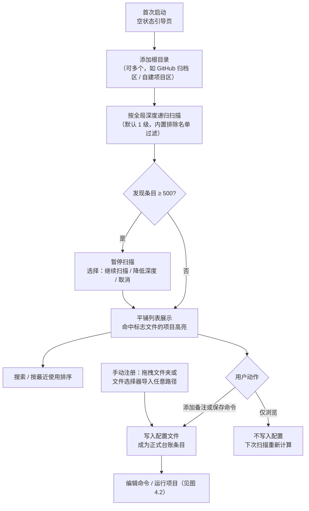
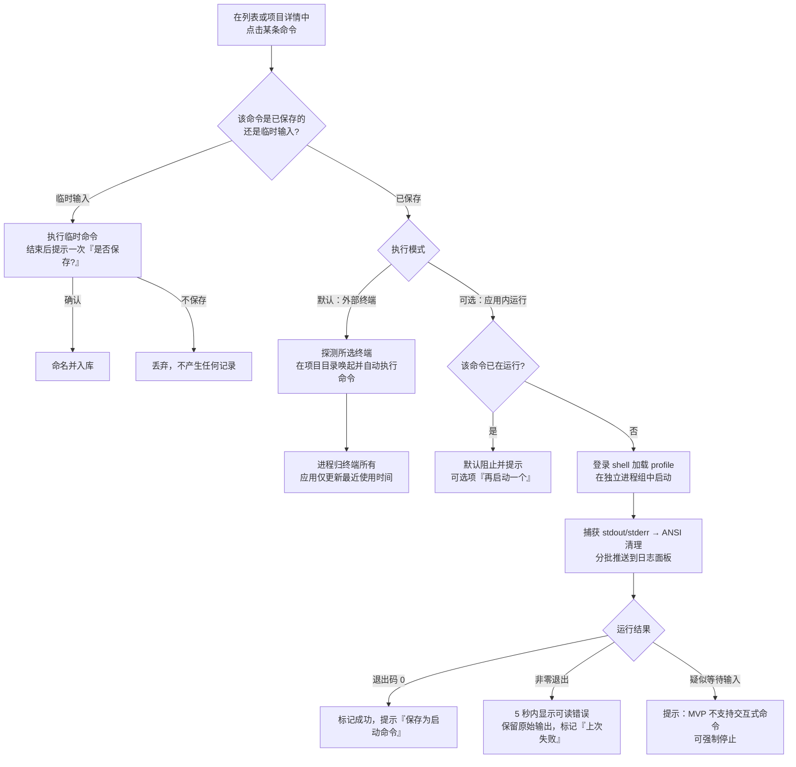
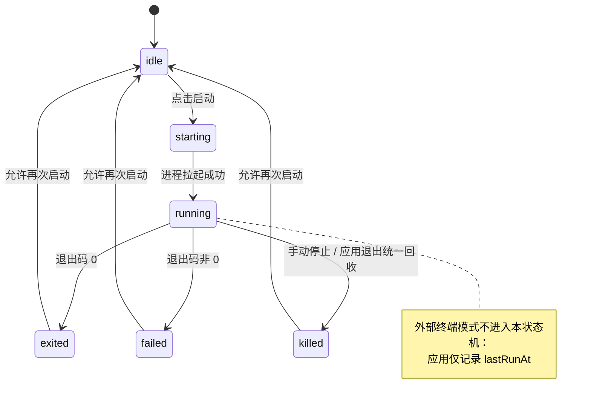
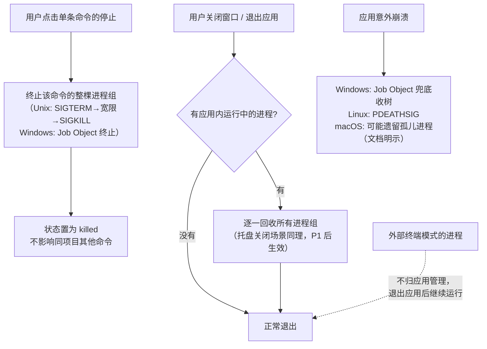

# 需求分析文档（汇总版）

| 项 | 内容 |
|---|---|
| 产品代号 | **Squirl**（松鼠的变体拼法——一只替你记住坚果埋在哪的松鼠） |
| 版本 | v1.0（汇总稿） |
| 日期 | 2026-10-31 |
| 来源 | 5 份需求文档平权汇总（原件已归档至 `docs/archive/`）：`PRD.md`、`需求分析.md`、`需求分析文档.md`、`需求-argon.md`、`需求-argon-dr.md` |
| 状态 | 汇总稿，关键分歧已由产品负责人裁决（见附录 A）；**未经明确授权不进入开发** |

> 裁决说明：本汇总以五份文档**平权重构**为原则，不预设任何一份为基线。所有冲突点（含产品名、存储方案、性能口径）均已由产品负责人逐项裁决，记录在附录 A。

---

## 1. 需求背景

### 1.1 一句话定位

**Squirl 是一个本地项目台账与一键启动中枢：把散落在多个根目录下的项目登记成一张可搜索的清单，记住每个项目该怎么跑，点一下就启动——默认在你惯用的终端里执行，也可切换为应用内运行并实时查看日志；由应用内启动的进程，在退出时全部收回。**

它明确**不是**：文件搜索器、环境管理器、IDE、终端替代品、重型 Git 客户端。

### 1.2 目标用户

- **主用户**：同时维护 10 个以上项目、跨 2 个以上技术栈、无固定 IDE 依赖的独立开发者或小团队开发者；尤其是高频「克隆开源项目来跑」的探索者/使用者模式人群。
- **非目标用户**：只维护 1~2 个项目的人（shell alias 足够）；重度依赖 IDE Run Configuration 的人；需要团队共享运行配置的场景（本产品是纯本地单人工具）。

### 1.3 核心痛点（五份文档共识，按出现频次排序）

1. **找不到**：项目散落在 `GitHub/`、`Projects/`、临时目录等多个根目录，想起项目想不起路径。
2. **上下文失忆**：忘了某个仓库当初为什么克隆、核心功能是什么、进行到哪一步。
3. **启动链路繁琐**：找目录 → 开对应终端 → cd → 激活环境 → 回忆命令，约 20~40 秒；不同终端间 PATH 可见性还不一致。
4. **命令与参数记不住**：`npm run dev` 还是 `pnpm dev`？全局 CLI 工具（如 `pi`、`dsh`、`codex`）忘了存在、忘了用途、忘了长参数组合。
5. **文档与配置割裂**（MVP 不解决，P2 扩展覆盖）：跑通开源项目要对照 README 填 `.env` / `application.yml`，在浏览器、编辑器、终端间来回切换；重复 install 造成冗余构建损耗。

### 1.4 产品边界（明确不做）

- **不做代码展示与编辑**：源码级开发一键移交外部 IDE。
- **环境自治（Bring Your Own Runtime）**：不内置、不安装、不接管任何语言运行时与 SDK；不建 `.venv`、不改锁文件。MVP 不做环境感知；P2 扩展引入「锁文件感知流水线」时也只做**状态探测与命令组装**（如自动注入激活指令、判断是否跳过已保存的 install 命令），仍不代管环境。
- 不做磁盘全盘扫描；不做 GitHub 克隆；不做多机同步与团队协作（远期以插件形式考虑）；MVP 不做托盘常驻。
- 不在项目目录内写入任何文件（元数据全部集中存放在应用自己的数据目录），保证被管理项目的 Git 工作区绝对纯净。

### 1.5 差异化与诚实评估

- **台账而非文件搜索**：带备注、可搜索、按最近使用排序，解决「我忘了它存在」。
- **适用任何技术栈**：不依赖项目声明做识别，「识别是猜测，记录是事实」——只要能在终端跑通一次，就能被记录复用。
- **轻量**：量化口径为安装包 ≤ 10MB、冷启动到可交互 ≤ 2 秒、空闲内存 ≤ 120MB、安装后磁盘占用 ≤ 30MB（验收口径；argon 系文档提出的更激进指标 <350ms / <45MB 作为追求目标，不作验收）。
- **诚实定位**：替代成本极低（alias、justfile、启动器 snippet），护城河接近于零，本产品适合作为**开源自用工具**而非创业项目；属于低频工具（预计每周 3~10 次），唯一真实留存钩子是**台账随时间增值**。不为它加统计图表、成就系统等留存装饰。

### 1.6 技术选型与约束

- **框架**：Tauri 2 + Rust 后端；**前端**：React + TypeScript + Tailwind CSS + shadcn/ui（五份文档中四份明确此组合，PRD 未指定 UI 库，不冲突）。
- **分工**：目录扫描、进程调度、配置读写等耗时操作全部在 Rust 后端；前端只负责交互与渲染。
- **存储**：本地 SQLite（WAL 模式，rusqlite/sqlx；事务保证写入原子性，自动备份保留最近 3 份，`schema_version` 支持迁移）【用户裁决 2026-10-31】。
- **分发**：GitHub Releases；Windows NSIS/MSI（实机验证）、macOS DMG、Linux AppImage/deb（产物照发，**无 macOS/Linux 实机，标注未经实机验证**，宣传材料不得写「三端可用」）；首发后补 Scoop bucket 与 Homebrew tap。
- **单实例运行**：二次启动只唤起已有窗口。

---

## 2. MVP 最小可行功能点

> 收缩原则（产品负责人裁决）：托盘、全局命令、多命令并行等挪到扩展第一批（P1）；招牌功能全部进扩展。执行引擎是最小不可再砍的部分。

### 2.1 范围总览

**多根目录扫描 → 可搜索的项目台账 → 命令显式保存 → 双模式一键启动（外部终端默认 / 应用内可选）→ 日志查看与单命令停止 → 退出时收回应用内全部进程。**

### 2.2 功能清单

**F1 多根目录与扫描**
- 根目录可添加/删除/启用禁用，可多个；全局扫描深度设置（默认 1，即只列一级子文件夹，上限 10）。
- 内置默认排除名单（`.git`、`node_modules`、`.venv`、`venv`、`__pycache__`、`target`、`dist`、`build`、`.next`、`.idea`、`.vscode` 等），MVP 不可编辑。
- 排除规则按条目名匹配；**所有文件夹都列出**，不做「必须有标志文件才算项目」的过滤；标志文件（`package.json`、`pyproject.toml`、`Cargo.toml`、`go.mod`、`pom.xml`、`Makefile`、`.git` 等）命中时**高亮**。
- 符号链接跟随，两条硬限制：已访问真实路径去重防环；不跟随指向根目录之外的目标。
- 累计 500 条时暂停扫描，提供「继续扫描 / 降低深度 / 取消」。
- 触发时机：添加根目录时全量扫一次 + 手动刷新按钮；**不做文件系统监听**。
- 性能：500 项扫描 < 1 秒，异步执行不阻塞界面。

**F2 项目台账**
- 平铺列表 + 相对路径展示，不做树形。
- 搜索覆盖项目名、路径、备注；100 个项目规模下 ≤3 字符定位、响应 < 200ms。
- 备注字段（记录「当初为什么克隆/它是什么」）；按最近使用排序（记录 `lastRunAt`）。
- 手动注册：拖拽或文件选择器导入系统任意位置的文件夹。
- 路径失效时列表标记「路径不存在」，提供「重新定位」，命令仍可见但不可运行。
- 扫描出的文件夹默认**瞬时、不写入配置**；只有用户添加备注或保存命令后才成为正式台账条目。

**F3 命令记录**
- 每项目多条命名命令，保存字段：名称、命令行原文、工作目录（默认项目根，可改）。
- **显式保存**：命令输入框填写 → 运行 → 提示「保存为启动命令」并预填名称 → 确认后入库。不偷偷记住键入内容。
- 填了命令但不保存：视为临时运行，运行结束提示一次「本次命令未保存，是否保存？」，不保存则丢弃。
- 命令失败也允许保存，记录 `lastExitCode` 并标记「上次失败」。

**F4 双模式执行引擎**（产品负责人裁决：外部默认 + 可选内置）
- **外部终端模式（默认）**：探测本机已装终端（Windows：pwsh / PowerShell / cmd / Git Bash / Windows Terminal；macOS：Terminal / iTerm2；Linux：常见终端），在项目工作目录唤起所选终端并自动执行命令。进程归终端所有，应用仅更新最近使用时间；应用退出不影响它们。
- **应用内模式（可选，勾选启用）**：解析 shell（Windows：pwsh 7+ → powershell.exe（警告 `&&` 不可用）→ cmd.exe；macOS/Linux：`$SHELL` → zsh/bash 回退），以登录 shell 执行（加载 profile，保证 nvm/conda/brew 可用），可全局修改。
- profile 初始化输出与命令输出分离，日志中加分隔线。
- **无交互**：不提供 stdin，不支持 Y/N 确认、交互式登录、sudo 密码；检测到疑似等待输入时提示并允许强制停止。
- 命令状态机 `idle → starting → running → exited(code) / failed / killed` 四态在 UI 上永远可见。
- 同一命令重复点击启动（应用内已在运行）：默认阻止并提示，提供「再启动一个」选项。

**F5 日志面板与停止**（应用内模式）
- 捕获 stdout/stderr，ANSI 归一化，分批推送（约 30ms/批）避免打爆 IPC。
- 每命令环形缓冲上限 5,000 行 / 2MB，超出丢弃最早内容；日志仅会话内存在，不落盘，应用重启清空。
- 单命令停止：终止该命令的整棵进程树（Windows Job Object + `JOB_OBJECT_LIMIT_KILL_ON_JOB_CLOSE`；Unix `setsid` 进程组，先 SIGTERM、宽限期后 SIGKILL），不影响其他命令。
- 子进程在独立进程组内启动；应用异常崩溃兜底：Windows 靠 Job Object、Linux 靠 `PR_SET_PDEATHSIG`、**macOS 无等价机制可能遗留孤儿进程（写入用户文档，不隐瞒）**。

**F6 生命周期与进程回收**
- MVP 无托盘：关闭窗口 = 退出应用；退出时回收**所有由应用内模式启动**的进程（重点验证 `npm run dev` 这类派生孙进程的命令）。
- 外部终端模式的进程不受影响（在用户文档中明示这一差异）。

**F7 最小设置页**
- 默认外部终端选择（显示探测结果）、默认 shell 路径显示与全局可改、是否加载 profile、扫描深度。

### 2.3 数据模型（MVP）

```
SQLite（WAL 模式；事务保证写入原子性；自动备份保留最近 3 份；schema_version 支持迁移）
├─ settings   { default_terminal, shell, load_shell_profile, scan_depth }
├─ roots      { id(UUID), path, enabled }
├─ projects   { id(UUID PK), path(规范化绝对路径，UNIQUE), name, note,
│              terminal_override?, created_at, last_run_at, run_count }
└─ commands   { id(UUID PK), project_id(FK → projects), name, command_line,
               cwd?, last_run_at, last_exit_code? }
```

- UUID 作主键（重命名/移动后引用不断），规范化绝对路径作唯一约束（防重复登记）。
- 数据目录用平台标准位置：Windows `%APPDATA%/squirl`、macOS `~/Library/Application Support/squirl`、Linux `~/.config/squirl`；卸载不清理配置。
- 安全事实（已接受）：命令以明文存于配置，可能含 token / API key；v1 不加密，密钥链（DPAPI/Keychain）列入扩展。

### 2.4 明确不进 MVP

托盘与双关闭语义、全局命令、同项目多命令并行、每根目录独立深度、自定义排除名单、按项目覆盖终端、技术栈图标、README 渲染、配置快填、环境感知流水线、交互式终端、参数模板、自动更新、导入导出、多机同步、端口占用检测、依赖检查、开机自启、文件监听、快捷键系统、命令面板 —— 均见第 3 节扩展清单。

### 2.5 估算与里程碑

| Epic | 内容 | 人天 |
|---|---|---|
| E1 基础设施 | Tauri 2 骨架、SQLite 存储（WAL/备份/迁移）、单实例、错误处理 | 3~4 |
| E2 项目台账 | 根目录管理、扫描（深度/排除/防环/500 上限）、列表与搜索、备注、手动注册、路径失效 | 3~4 |
| E3 执行引擎 | 外部终端探测与唤起（2）；应用内登录 shell、进程组、日志管道、ANSI 清理、停止与树清理、状态机（5~7） | 7~9 |
| E4 界面 | 主列表、项目详情、命令编辑器、日志面板、运行/停止控件、最小设置页 | 4~5 |
| E5 生命周期 | 退出回收语义、崩溃兜底 | 1~2 |
| E6 打包分发 | GH Actions、NSIS 优先，DMG/AppImage 产物生成（未实机验证）、README | 2~3 |
| E7 加固验收 | 执行第 5 节全部验收项、修复、性能调优 | 2~3 |
| **合计** | | **约 22~30 人天**（全职 3~4 周；业余每天 3 小时约 6~9 周） |

> 若需进一步压缩到「一口气」体量（10~14 人天）：可将**应用内模式整体降级为 P1**，MVP 只做外部终端模式——但这会砍掉日志面板与进程回收，属于产品负责人决策项。

**里程碑 M0（第一个开发动作，须单独授权）**：先跑通双模式最危险链路——「唤起外部终端执行」+「登录 shell 启动 → 捕获输出 → 杀掉整棵进程树」。M0 无法在 2 周内完成则重评技术选型，不继续投入 UI。

---

## 3. 后续扩展功能点（按优先级）

### P1 —— 补全核心体验（MVP 后第一批）

| # | 功能 | 说明 | 来源 |
|---|---|---|---|
| 1 | 系统托盘（默认关闭） | 关窗=隐藏到托盘进程继续，托盘「退出」才杀全部；Linux 托盘初始化失败自动降级为普通窗口应用 | PRD |
| 2 | 全局命令 | 与项目同一数据实体 `type: global`，不绑定根目录，工作目录默认主目录；覆盖「忘了有哪些工具、带固定参数的长命令」 | PRD |
| 3 | 同项目多命令并行 | 多条命令同时启动，各自独立日志与独立停止 | PRD |
| 4 | 每根目录独立深度 + 自定义排除名单 | 多级扫描噪音控制；排除名单用户可增删 | PRD |
| 5 | 按项目覆盖终端/Shell | 不同项目绑定不同终端 | argon 系 |
| 6 | 外部 IDE 一键打开 | `code .` / Cursor / JetBrains / 文件管理器，成本低 | argon 系 |

### P2 —— 差异化招牌（探索期四份文档的主打卖点）

| # | 功能 | 说明 | 来源 |
|---|---|---|---|
| 7 | 锁文件指纹感知流水线 | 三段式：① 会话前置环境注入（检测 `.venv` 按终端方言生成激活指令）；② 幂等初始化（首次 install 成功后记录锁文件 SHA-256 + `node_modules` 存在性，未变更自动跳过，变更/缺失自动恢复执行，支持强制重跑）；③ 主运行命令 | argon×2 头号亮点 |
| 8 | README×配置双栏快填台 | 左栏渲染 README（GFM、代码高亮、一键设为启动命令），右栏列出 `.env*` / `*.yml` / `*.toml` 键值表单；`.env.example` 一键转正；magpie 式**保格式原子重写**（100% 保留注释/缩进/键序）；表单聚焦时 README 自动滚动到对应变量段落 | 4 份文档共识主打 |
| 9 | 全局 CLI 词典升级 | 工具用途备忘、分类、文档链接；`{{param}}` 参数模板填空执行（`dsh deploy {{service}} --env={{env:dev\|prod}}`） | argon 系 + PRD v1.1 |
| 10 | 技术栈图标徽章 | oh-my-posh 风格矢量徽章，语言/框架/包管理器细分（纯展示，零核心价值故不进 MVP） | 4 份文档 |
| 11 | Git 元数据与初心便签增强 | 读取 remote URL（点击直达）、最后 commit 时间；GitHub 描述/Topics 回填「官方简介」 | argon |
| 12 | 一键休眠瘦身 | 清理 `node_modules`/`.venv`/`target` 释放磁盘，保留备注、命令与已填配置，状态重置为「待初始化」 | argon×2 |
| 13 | 文件监听自动刷新 | `notify` 监听根目录，外部 `git pull`/新增项目自动更新列表 | argon 系 |
| 14 | 交互式内置终端（xterm） | 提供 stdin，支持交互式命令 | PRD v1.1 |

### P3 —— 生态与平台化（远期）

| # | 功能 | 说明 | 来源 |
|---|---|---|---|
| 15 | 插件架构 | `manifest.json` + 生命周期钩子 + 声明式 JSON Schema UI（宿主统一渲染）；WASM 沙箱为可选强化，形态在启动前再裁决 | 需求分析.md / argon-dr / Obsidian 范式 |
| 16 | 跨设备同步插件 | 根目录别名 + Git Remote URL 双锚点映射实现跨机对齐；Git / WebDAV / 云盘镜像；终端配置按平台独立存储；敏感配置本地加密后同步 | argon×2 |
| 17 | 端口雷达 | `netstat2` + `sysinfo`：启动前端口冲突预检、运行中项目监听端口徽章、一键浏览器跳转、终止冲突进程 | argon-dr + PRD v1.1 |
| 18 | Shell Doctor 预检 | 正式唤起前在目标 shell 上下文做亚毫秒级命令可见性预检，跨终端 PATH 缺失时给一键修复 | argon-dr |
| 19 | MCP Server / AI skills 导出 | 供 Claude Code、Codex 等查询项目台账、备注与全局命令速查表 | argon-dr |
| 20 | 其他 | 导入导出、自动更新、开机自启、快捷键系统、Ctrl+K 命令面板、命令级环境变量、密钥链加密（DPAPI/Keychain）、macOS 崩溃孤儿 PID 回收、卸载清理选项 | PRD v1.1 清单 |

---

## 4. 用户操作流程图

### 4.1 首次使用与项目入库



### 4.2 一键启动（双模式）



### 4.3 命令状态机（应用内模式）



### 4.4 停止与退出进程回收



---

## 5. 需求功能核对清单

### A. 基础设施

- [ ] Tauri 2 + React + TypeScript + Tailwind + shadcn/ui 项目骨架
- [ ] SQLite 存储（WAL 模式，rusqlite/sqlx）：事务写入、自动备份保留 3 份、`schema_version` 迁移
- [ ] 数据库损坏自动回退备份并提示，不丢全部数据
- [ ] 数据目录用平台标准位置，绝不写入被管理的项目目录
- [ ] 单实例运行（二次启动唤起已有窗口）

### B. 项目发现与台账（F1/F2）

- [ ] 多根目录添加 / 删除 / 启用禁用
- [ ] 递归扫描：全局深度设置（默认 1、上限 10）、内置默认排除名单
- [ ] 所有文件夹平铺列出 + 相对路径；标志文件命中高亮
- [ ] 符号链接：已访问真实路径去重防环、不跟随根外目标
- [ ] 500 条暂停扫描，提供「继续 / 降低深度 / 取消」
- [ ] 手动刷新按钮触发重扫（无文件监听）
- [ ] 扫描异步不阻塞界面，500 项 < 1 秒
- [ ] 搜索覆盖项目名 / 路径 / 备注，100 项目 < 200ms
- [ ] 备注字段 + 最近使用排序（`lastRunAt`）
- [ ] 手动注册：拖拽 / 文件选择器导入任意路径
- [ ] 路径失效标记「路径不存在」+ 重新定位，命令不可运行但可见
- [ ] 仅浏览的扫描结果不写入配置

### C. 命令记录（F3）

- [ ] 每项目多条命名命令（名称 / 命令行原文 / 工作目录默认项目根可改）
- [ ] 显式保存流程：运行后提示保存并预填名称
- [ ] 临时运行结束提示一次「是否保存」，不保存则丢弃
- [ ] 失败命令允许保存，记录 `lastExitCode` 并标记「上次失败」
- [ ] 命令编辑 / 删除

### D. 双模式执行引擎（F4）

- [ ] 终端探测：Windows（pwsh / PowerShell / cmd / Git Bash / WT）、macOS（Terminal / iTerm2）、Linux（常见终端）
- [ ] 外部模式：在项目目录唤起所选终端并自动执行命令
- [ ] 内置模式 shell 解析：pwsh 7+ → powershell.exe（警告 `&&` 不可用）→ cmd.exe；`$SHELL` → zsh/bash 回退；设置页显示实际解析路径
- [ ] 登录 shell 加载 profile（`pwsh -Login -NoLogo` / `zsh -lic` / `bash -lic`）
- [ ] profile 噪音与命令输出分离（分隔线）
- [ ] 无 stdin：疑似等待输入时提示并允许强制停止
- [ ] 重复启动（应用内已在运行）默认阻止并提示，提供「再启动一个」
- [ ] 命令状态机四态（idle / starting / running / exited / failed / killed）UI 可见

### E. 日志面板与停止（F5）

- [ ] stdout/stderr 捕获、ANSI 归一化、约 30ms 分批推送
- [ ] 每命令环形缓冲 5,000 行 / 2MB，超出丢弃最早内容
- [ ] 日志仅会话内存在，不落盘
- [ ] 子进程独立进程组（Windows Job Object `KILL_ON_JOB_CLOSE`；Unix `setsid`）
- [ ] 单命令停止：SIGTERM → 宽限期 → SIGKILL 整组，不影响其他命令

### F. 生命周期（F6）

- [ ] 关闭窗口 = 退出应用；退出时回收全部应用内启动的进程
- [ ] 外部终端模式进程不受应用退出影响（用户文档明示）
- [ ] 崩溃兜底：Windows Job Object / Linux `PR_SET_PDEATHSIG` / macOS 孤儿风险写入文档

### G. 最小设置页（F7）

- [ ] 默认外部终端选择（显示探测结果）
- [ ] 默认 shell 显示与全局可改、是否加载 profile
- [ ] 扫描深度设置

### H. 打包分发与验收

- [ ] GitHub Actions：Windows NSIS/MSI（实机验证），macOS DMG、Linux AppImage/deb（标注未实机验证）
- [ ] README 首屏写明 Squirl 命名来历与话术
- [ ] M0 技术验证先行：2 周内跑通双模式最危险链路
- [ ] AC1 台账完整：10 个真实项目登记（含备注、命令），双模式各触发一轮且输出可见
- [ ] AC2 冷启动：双击图标到窗口可交互 ≤ 2 秒
- [ ] AC3 启动延迟：内置模式点击到首行输出 ≤ 5 秒（profile 加载例外注明）；外部模式点击到终端窗口出现 ≤ 2 秒
- [ ] AC4 零残留进程（内置模式）：退出应用后任务管理器验证无残留，10/10 用例，重点 `npm run dev` 孙进程
- [ ] AC5 错误可见：非零退出或命令不存在 ≤ 5 秒显示可读错误，保留原始输出
- [ ] AC6 检索：100 项目规模 ≤3 字符定位、< 200ms
- [ ] AC7 扫描克制：深度 / 排除名单 / 500 条暂停在含 `node_modules` 的真实目录生效
- [ ] AC8 不污染项目：扫描 + 运行 + 停止全流程前后项目根快照无任何新增 / 修改文件
- [ ] AC9 配置健壮：手动破坏 SQLite 数据库文件后应用可启动、自动回退备份、给出提示

---

## 附录 A：冲突裁决记录（五份平权重构）

| # | 冲突点 | 各文档立场 | 裁决 | 依据 |
|---|---|---|---|---|
| 1 | 执行模式 | PRD：应用内执行（方案 A，基线确认）；`需求分析文档.md`：外部终端；argon-dr：推荐双模式（方案 B） | **双模式：外部终端默认 + 可选应用内运行** | 【用户裁决 2026-10-31】按最新决策覆盖 PRD 基线；外部模式保留零成本原生交互，内置模式补日志与进程回收 |
| 2 | MVP 体量 | PRD：14 项、30~40 人天；其余文档：8~12 周大而全 | **再砍一刀至约 20~30 人天**：托盘 / 全局命令 / 多命令并行等移 P1 | 【用户裁决】MVP 要最核心、能一口气完成 |
| 3 | 招牌功能归置 | 探索期四份文档列为 P0 核心 | **全部列入扩展**，按 P1/P2/P3 排序 | 【用户裁决】MVP 保持克制 |
| 4 | 存储方案 | PRD：单 JSON 原子写；`需求分析.md`/argon-dr：SQLite（WAL） | **MVP 用 SQLite（WAL + 自动备份 3 份 + `schema_version` 迁移）** | 【用户裁决 2026-10-31】采纳 argon 系方案：查询与并发更强，为 P3 同步/插件阶段预置数据底座；复杂度上升已计入 E1 估算 |
| 5 | 产品名 | PRD：Squirl（七轮命名战役已定名）；其余：DevDeck / DevDock / DevPort 等暂定名 | **沿用 Squirl** | 【用户裁决 2026-10-31】唯一经命名验证、npm/crates.io 空闲、有完整取舍记录的名字；其余均为「暂定」 |
| 6 | 环境感知（.venv 激活 / 锁文件跳过 install） | PRD 边界明确不做；探索期四份文档当核心卖点 | **MVP 不做；P2 引入锁文件感知流水线**；边界统一为「环境自治：不代管运行时安装，只做状态探测与命令组装」 | 平权综合：保留 BYOR 原则，承认锁文件感知是高价值扩展 |
| 7 | 文件监听 | PRD 明确不做；argon 系要求 `notify` 监听 | **MVP 手动刷新；P2 加监听** | 与 MVP 收缩一致 |
| 8 | UI 基座 | PRD：React+TS+Vite（未指定样式库）；其余四份：+Tailwind+shadcn/ui | **Tauri 2 + React + TS + Vite + Tailwind + shadcn/ui** | 四份共识，不与 PRD 冲突 |
| 9 | 性能口径 | PRD：冷启动 ≤2s / 空闲 ≤120MB；argon 系：<350ms / 25~45MB | **验收采用 PRD 保守口径**，激进值作追求目标 | 【用户裁决 2026-10-31】验收标准必须可证伪、可在现有开发机实测 |
| 10 | 多命令并行 | PRD 进 MVP；本次收缩 | **移 P1** | 与裁决 2 一致（引擎按单命令构建，扩展成本低） |

## 附录 B：来源文档对照

| 来源文档 | 吸收内容 |
|---|---|
| `PRD.md` | MVP 功能与业务规则主体、数据模型、验收标准（AC1~9）、执行引擎细节（shell 解析 / 进程组 / 日志管道）、性能验收口径、风险与诚实定位、退出回收语义 |
| `需求分析.md`（DevDeck） | 痛点四维拆解、竞品表、环境自治原则、外科手术式配置编辑（P2）、SQLite 存储方案（附录 A 裁决 4，已采纳为 MVP 存储）、三阶段路线参考 |
| `需求分析文档.md`（Draft v1.0） | 痛点-价值验证表、全局 CLI 命令与组合（Snippet）思路（P2 #9）、标签分组雏形（并入台账备注/搜索） |
| `需求-argon.md` | 锁文件 Hash 跳过、README×配置双栏、初心便签、参数槽位、休眠瘦身、Scoop/Homebrew 分发方案（P2/P3 与 H 节） |
| `需求-argon-dr.md` | 三段式指纹流水线细则、保格式原子重写、Shell Doctor、端口雷达、MCP Server、跨设备同步双锚点机制（P2/P3） |
