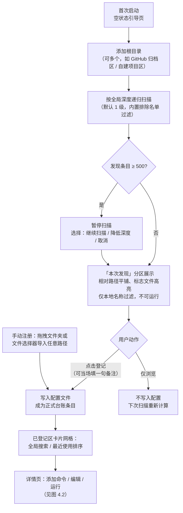
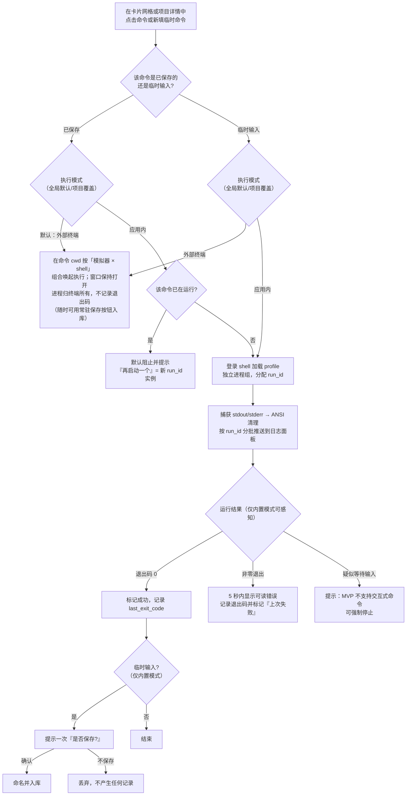
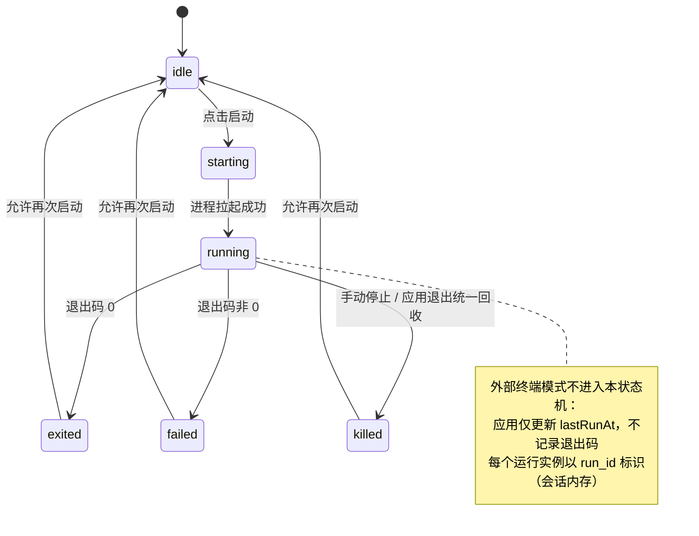
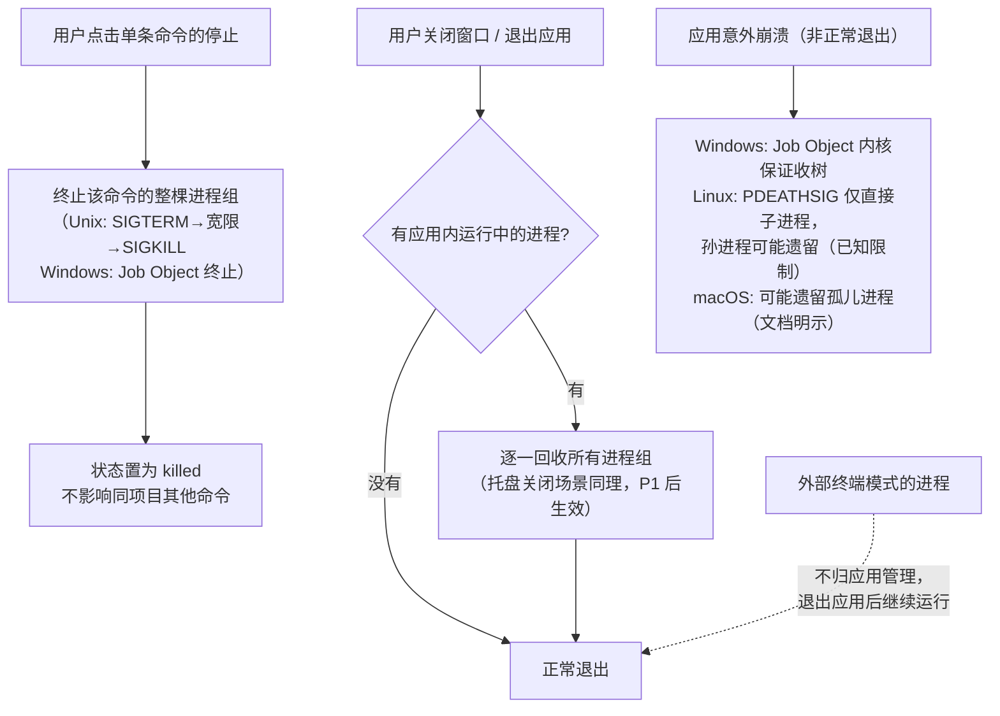

# 需求分析文档（汇总版）

| 项 | 内容 |
|---|---|
| 产品代号 | **Squirl**（松鼠的变体拼法——一只替你记住坚果埋在哪的松鼠） |
| 版本 | v1.0（汇总稿） |
| 日期 | 2026-10-31 |
| 来源 | 5 份需求文档平权汇总（原件已归档至 `docs/archive/`）：`PRD.md`、`需求分析.md`、`需求分析文档.md`、`需求-argon.md`、`需求-argon-dr.md` |
| 状态 | 需求定稿，关键设计决策见附录 A；**未经明确授权不进入开发** |

> 本汇总以五份文档**平权重构**为原则，不预设任何一份为基线；所有冲突点已由产品负责人裁决，最终决策统一记录在附录 A。

---

## 1. 需求背景

### 1.1 一句话定位

**Squirl 是一个本地项目台账与一键启动中枢：把散落在多个根目录下的项目登记成一张可搜索的清单，记住每个项目该怎么跑，点一下就启动——默认在你惯用的终端里执行，也可切换为应用内运行并实时查看日志；由应用内启动的进程，在退出时全部收回。**

它明确**不是**：文件搜索器、环境管理器、IDE、终端替代品、重型 Git 客户端。

### 1.2 目标用户

- **主用户**：同时维护 10 个以上项目、跨 2 个以上技术栈、无固定 IDE 依赖的独立开发者或小团队开发者；尤其是高频「克隆开源项目来跑」的探索者/使用者模式人群。
- **非目标用户**：只维护 1~2 个项目的人（shell alias 足够）；重度依赖 IDE Run Configuration 的人；需要团队共享运行配置的场景（本产品是纯本地单人工具）。

### 1.3 核心痛点（五份文档共识，按出现频次排序）

1. **找不到**：项目散落在 `GitHub/`、`Projects/`、临时目录等多个根目录，想起项目想不起路径。
2. **上下文失忆**：忘了某个仓库当初为什么克隆、核心功能是什么、进行到哪一步。
3. **启动链路繁琐**：找目录 → 开对应终端 → cd → 激活环境 → 回忆命令，约 20~40 秒；不同终端间 PATH 可见性还不一致。
4. **命令与参数记不住**：`npm run dev` 还是 `pnpm dev`？全局 CLI 工具（如 `pi`、`dsh`、`codex`）忘了存在、忘了用途、忘了长参数组合。
5. **文档与配置割裂**（MVP 不解决，P2 扩展覆盖）：跑通开源项目要对照 README 填 `.env` / `application.yml`，在浏览器、编辑器、终端间来回切换；重复 install 造成冗余构建损耗。

### 1.4 产品边界（明确不做）

- **不做代码展示与编辑**：源码级开发一键移交外部 IDE。
- **环境自治（Bring Your Own Runtime）**：不内置、不安装、不接管任何语言运行时与 SDK；不建 `.venv`、不改锁文件。MVP 不做环境感知；P2 扩展引入「锁文件感知流水线」时也只做**状态探测与命令组装**（如自动注入激活指令、判断是否跳过已保存的 install 命令），仍不代管环境。
- 不做磁盘全盘扫描；不做 GitHub 克隆；不做多机同步与团队协作（远期以插件形式考虑）；MVP 不做托盘常驻。
- 不在项目目录内写入任何文件（元数据全部集中存放在应用自己的数据目录），保证被管理项目的 Git 工作区绝对纯净。

### 1.5 差异化与诚实评估

- **台账而非文件搜索**：带备注、可搜索、按最近使用排序，解决「我忘了它存在」。
- **适用任何技术栈**：不依赖项目声明做识别，「识别是猜测，记录是事实」——只要能在终端跑通一次，就能被记录复用。
- **轻量**：量化口径为安装包 ≤ 10MB、冷启动到可交互 ≤ 2 秒、空闲内存 ≤ 120MB、安装后磁盘占用 ≤ 30MB（验收口径；argon 系文档提出的更激进指标 <350ms / <45MB 作为追求目标，不作验收）。
- **诚实定位**：替代成本极低（alias、justfile、启动器 snippet），护城河接近于零，本产品适合作为**开源自用工具**而非创业项目；属于低频工具（预计每周 3~10 次），唯一真实留存钩子是**台账随时间增值**。不为它加统计图表、成就系统等留存装饰。

### 1.6 技术选型与约束

- **框架**：Tauri 2 + Rust 后端；**前端**：React + TypeScript + Vite + Tailwind CSS + shadcn/ui。
- **分工**：目录扫描、进程调度、配置读写等耗时操作全部在 Rust 后端；前端只负责交互与渲染。
- **UI 形态**：主窗口同页两分区（已登记网格 + 本次发现）+ 项目详情页；UI 文案英文，引入 react-i18next。
- **存储**：本地 SQLite（WAL 模式，rusqlite/sqlx；事务保证写入原子性，自动备份保留最近 3 份，`schema_version` 支持迁移）。
- **分发**：GitHub Releases；Windows NSIS/MSI（实机验证）、macOS DMG、Linux AppImage/deb（产物照发，**无 macOS/Linux 实机，标注未经实机验证**，宣传材料不得写「三端可用」）；首发后补 Scoop bucket 与 Homebrew tap。
- **单实例运行**：二次启动只唤起已有窗口。

---

## 2. MVP 最小可行功能点

> 收缩原则：托盘、全局命令、多会话管理 UI 等挪到扩展第一批（P1）；招牌功能全部进扩展。执行引擎是最小不可再砍的部分。

### 2.1 范围总览

**多根目录扫描 → 可搜索的项目台账 → 命令显式保存 → 双模式一键启动（外部终端默认 / 应用内可选）→ 日志查看与单命令停止 → 退出时收回应用内全部进程。**

### 2.2 功能清单

**F1 多根目录与扫描**
- 根目录可添加/删除/启用禁用，可多个；全局扫描深度设置（默认 1，即只列一级子文件夹，上限 10）。
- 内置默认排除名单（`.git`、`node_modules`、`.venv`、`venv`、`__pycache__`、`target`、`dist`、`build`、`.next`、`.idea`、`.vscode` 等），MVP 不可编辑。
- 排除规则按条目名匹配；**所有文件夹都列出**，不做「必须有标志文件才算项目」的过滤；标志文件（`package.json`、`pyproject.toml`、`Cargo.toml`、`go.mod`、`pom.xml`、`Makefile`、`.git` 等）命中时**高亮**。
- 符号链接跟随，两条硬限制：已访问真实路径去重防环；不跟随指向根目录之外的目标。
- 全部根目录累计 500 条时暂停扫描，提供「继续扫描 / 降低深度 / 取消」。
- 触发时机：添加根目录时全量扫一次 + 手动刷新按钮；**不做文件系统监听**。
- 性能：500 项扫描 < 1 秒，异步执行不阻塞界面。

**F2 项目台账与发现视图**
- 主窗口分两区（见 F8）：上方「**已登记**」卡片网格——可全局搜索、可运行；下方「**本次发现**」可折叠分区——最近一次扫描的未登记条目。
- 搜索（作用于已登记区）覆盖项目名、路径、备注、命令名四项；100 个项目规模下 ≤3 字符定位、响应 < 200ms。
- 已登记卡片展示：名称、路径、备注摘要、命令快启按钮、最近使用时间（按 `lastRunAt` 排序）、运行状态标记。
- **本次发现区规则**：内容为最近一次扫描结果（瞬时、不写入配置、重扫重算），以相对路径平铺展示、不做树形；按名称本地过滤，**不入全局搜索**；命中标志文件高亮；每项提供「**登记**」按钮；**未登记项不可运行**（登记 = 创建台账条目，可只写备注）。
- 手动注册：拖拽或文件选择器导入系统任意位置的文件夹。
- **归属规则**：项目的归属根 = `path_normalized` 命中的**最长根前缀**（嵌套根重叠时归更深者，派生计算、不落库）；手动注册或所属根被删除 = 无归属——条目保留、仅手动管理、不被扫描刷新。
- 路径失效时标记「路径不存在」，提供「重新定位」，命令仍可见但不可运行。

**F3 命令记录**
- 每项目多条命名命令，保存字段：名称、命令行原文、工作目录（默认项目根、可改，**两种模式共用**）。
- **显式保存**：命令输入框旁提供常驻**「保存」按钮**（两种模式通用，填写后随时可存，需确认名称——不偷偷记住键入内容）。
- **运行结束提示（仅内置模式）**：应用可感知命令结束，临时命令结束后提示一次「本次命令未保存，是否保存？」，不保存则丢弃；**外部模式无法感知命令结束，不做该提示**，保存依赖「保存」按钮。
- `last_exit_code` 与「上次失败」标记**仅内置模式记录**；外部模式进程归终端所有，`last_exit_code` 恒为 NULL，仅更新 `last_run_at`。
- 临时命令按当前执行模式（全局默认或项目覆盖）执行。
- 内置模式下运行中的命令禁止删除（需先停止）；编辑允许，但不影响已运行进程。

**F4 双模式执行引擎**
- **两层配置**：**Shell 层**（决定命令解释与 profile 加载，两种模式共用）与**终端模拟器层**（决定外部模式开哪个窗口，仅外部模式）。全局默认 + 项目级覆盖：`execution_override { mode?, emulator?, shell? }`（均可「跟随全局」或指定）。
- **Shell 层（默认解析优先级）**：Windows：pwsh 7+ → powershell.exe 5.1（警告 `&&` 不可用）→ cmd.exe；macOS/Linux：`$SHELL`（在支持列表内）→ zsh → bash。设置页显示实际解析到的 shell 路径。
- **模拟器层（默认探测优先级）**：Windows：Windows Terminal → 默认控制台宿主；macOS：Terminal → iTerm2；Linux：按探测（GNOME Terminal / Konsole / Alacritty 等）。设置页可改。
- **外部模式（默认）**：以「模拟器 × shell」组合在**命令的工作目录**（`cwd`，默认项目根、可改，与内置模式一致）唤起并执行命令原文（如 Git Bash 预设 = Git for Windows bash，模拟器可为 mintty 或 Windows Terminal）。**命令执行完后窗口保持打开**（交互参数如 `-NoExit`），用户查看输出后自行关闭，防止报错闪退看不到原因。进程归终端所有，应用仅更新 `last_run_at`、不记录退出码；应用退出不影响它们。
- **逐 shell 参数与 profile（两模式共用）**：

| shell | 参数 | profile |
|---|---|---|
| pwsh 7+ | `-Login -NoLogo` | 默认加载；`-Login` 主要作用于 Unix 的 /etc/profile |
| powershell.exe 5.1 | `-NoLogo`（无 `-Login` 参数） | `-Command` 默认加载 |
| cmd.exe | `/c`（内置）/ `/k`（外部保持打开） | 无 profile 概念，不处理 AutoRun |
| bash / zsh | `-lic` | 登录 + 交互式加载，保证 nvm / conda / brew 可用 |
| fish / nushell / csh 等 | **MVP 不支持**：探测到 `$SHELL` 指向它们时回退默认链（zsh → bash）并在设置页提示 | — |

- **终端适配器规约**：每个「模拟器 × shell」组合定义「唤起参数模板 + 命令传递方式（`-Command` / `-c` 直传命令原文，不经二次 shell 解析）+ 特殊字符转义规则 + 保持打开参数」；MVP 适配：Windows（Windows Terminal / 控制台宿主 × pwsh / PowerShell / cmd / Git Bash）、macOS（Terminal / iTerm2 × zsh / bash）、Linux 常见组合 1~2 种；转义正确性（含空格 / 引号 / `&` / 中文路径的命令冒烟）列入 M0 验证。
- profile 初始化输出与命令输出分离，日志中加分隔线。
- **无交互**：不提供 stdin，不支持 Y/N 确认、交互式登录、sudo 密码；检测到疑似等待输入时提示并允许强制停止。
- 命令状态机共六个状态：`idle / starting / running / exited(code) / failed / killed`，当前状态在 UI 上永远可见。**运行实例以 `run_id` 标识**（UUID，仅会话内存、不落库）：每次启动分配 run_id，同命令「再启动一个」即独立实例，日志缓冲、进程组句柄与停止操作均按 run_id 归属；`commands.last_run_at / last_exit_code` 记录最近一次实例结果。
- **内置模式并发**：允许同项目不同命令并行运行（各自独立进程组、独立停止）；MVP 日志面板聚焦单条命令，多会话管理 UI（日志标签 / 批量停止）归 P1。
- 同一命令重复点击启动（应用内已在运行）：默认阻止并提示，提供「再启动一个」选项。

**F5 日志面板与停止**（应用内模式）
- 捕获 stdout/stderr，ANSI 归一化，分批推送（约 30ms/批）避免打爆 IPC。
- 每命令环形缓冲上限 5,000 行 / 2MB，超出丢弃最早内容；日志仅会话内存在，不落盘，应用重启清空。
- 单命令停止：终止该命令的整棵进程树（Windows Job Object + `JOB_OBJECT_LIMIT_KILL_ON_JOB_CLOSE`；Unix `setsid` 进程组，先 SIGTERM、宽限期后 SIGKILL），不影响其他命令。
- 子进程在独立进程组内启动。
- **进程回收分两条路径，不得混同**：① **正常退出 / 手动停止**——整组回收（Unix `kill(-pgid)`、Windows Job Object 终止），可收含孙进程的整组，AC4 仅验此路径；② **应用异常崩溃兜底**——Windows Job Object 由内核保证收树；Linux `PR_SET_PDEATHSIG` **仅保证直接子进程，孙进程可能遗留**；macOS 无等价机制，可能遗留孤儿。②属已知限制，写入用户文档，不隐瞒。

**F6 生命周期与进程回收**
- MVP 无托盘：关闭窗口 = 退出应用；退出时回收**所有由应用内模式启动**的进程（重点验证 `npm run dev` 这类派生孙进程的命令）。
- 外部终端模式的进程不受影响（在用户文档中明示这一差异）。

**F7 最小设置页**
- 默认执行模式（外部 / 内置）、默认终端模拟器（显示探测结果）、默认 shell（显示解析路径与支持状态，未支持 shell 给出回退提示）、是否加载 profile、扫描深度。

**F8 界面布局与文案语言**
- 主窗口为**同页两分区**：上方「**已登记**」卡片网格——搜索框（覆盖项目名 / 路径 / 备注 / 命令名）+ 项目卡片（名称、路径、备注摘要、命令快启按钮、最近使用时间、运行状态标记），顶部提供添加根目录与手动注册入口；下方「**本次发现**」可折叠分区——未登记扫描条目（名称本地过滤、「登记」按钮、标志文件高亮，**不入全局搜索、不可运行**）。
- 点击卡片进入**项目详情页**：备注编辑、命令列表（运行 / 停止 / 编辑）、执行模式与模拟器 / shell 覆盖、日志面板（内置模式）。
- UI 文案**英文**，第一日引入 i18n 架构（react-i18next），为后续中文包留位；代码注释与项目文档仍用中文。

### 2.3 数据模型（MVP）

```
SQLite（WAL 模式；事务保证写入原子性；**备份用 SQLite Backup API / `VACUUM INTO` 产出一致性快照，禁止直接复制 db 文件**，启动时与正常退出时执行、滚动保留 3 份，启动检测到损坏自动以最近备份恢复；schema_version 支持迁移）
├─ settings   { id INTEGER PK CHECK(id=1), default_mode, default_emulator,
│              default_shell, load_shell_profile, scan_depth }   // 单行表
├─ roots      { id(UUID), path, path_normalized(UNIQUE), enabled }
├─ projects   { id(UUID PK), path, path_normalized(UNIQUE), name, note,
│              execution_override? { mode?, emulator?, shell? },  // null = 跟随全局
│              created_at, last_run_at, run_count }        // run_count 仅入库，MVP 无 UI
└─ commands   { id(UUID PK), project_id(FK → projects), name, command_line,
               cwd?, last_run_at, last_exit_code? }  // last_exit_code 仅内置模式写入，外部模式恒 NULL

运行实例（仅会话内存，不落库）：run_id(UUID) → { command_id, 进程组句柄, 日志缓冲 }；
每次启动分配 run_id，同命令可多实例并行；停止 / 日志 / 状态均以 run_id 为键。

路径规范化：所有 path 存绝对路径 + 平台原生分隔符；唯一约束建在 `path_normalized` 列——
Windows / macOS 折叠小写、Linux 保留大小写；Windows 解析 UNC 与盘符映射，>260 字符路径加 `\\?\` 前缀。

项目归属（派生，不落库）：归属根 = path_normalized 命中的最长根前缀（嵌套根归更深者）；
无匹配根（手动注册或根已删除）= 无归属，条目保留、不被扫描刷新。
```

- UUID 作主键（重命名/移动后引用不断），规范化绝对路径作唯一约束（防重复登记）。
- 数据目录用平台标准位置：Windows `%APPDATA%/squirl`、macOS `~/Library/Application Support/squirl`、Linux `~/.config/squirl`；卸载不清理配置。
- 安全事实（已接受）：命令以明文存于配置，可能含 token / API key；v1 不加密，密钥链（DPAPI/Keychain）列入扩展。

### 2.4 明确不进 MVP

托盘与双关闭语义、全局命令、内置模式多会话管理 UI（日志标签 / 批量停止）、每根目录独立深度、自定义排除名单、技术栈图标、README 渲染、配置快填、环境感知流水线、交互式终端、参数模板、自动更新、导入导出、多机同步、端口占用检测、依赖检查、开机自启、文件监听、快捷键系统、命令面板 —— 均见第 3 节扩展清单。

### 2.5 估算与里程碑

| Epic | 内容 | 人天 |
|---|---|---|
| E1 基础设施 | Tauri 2 骨架、SQLite 存储（WAL/备份/迁移）、单实例、错误处理 | 3~4 |
| E2 项目台账 | 根目录管理、扫描（深度/排除/防环/500 上限）、列表与搜索、备注、手动注册、路径失效 | 3~4 |
| E3 执行引擎 | 外部终端探测与唤起（2）；应用内登录 shell、进程组、日志管道、ANSI 清理、停止与树清理、状态机（5~7） | 7~9 |
| E4 界面 | 卡片网格、项目详情页、命令编辑器、日志面板、运行/停止控件、项目级执行覆盖、i18n 接入、最小设置页 | 6~8 |
| E5 生命周期 | 退出回收语义、崩溃兜底 | 1~2 |
| E6 打包分发 | GH Actions、NSIS 优先，DMG/AppImage 产物生成（未实机验证）、README | 2~3 |
| E7 加固验收 | 执行第 5 节全部验收项、修复、性能调优 | 2~3 |
| **合计** | | **约 24~33 人天**（= 192~264 小时；全职约 5~7 周；业余每天 3 小时约 9~13 周） |

> 若需进一步压缩到「一口气」体量（10~14 人天）：可将**应用内模式整体降级为 P1**，MVP 只做外部终端模式——但这会砍掉日志面板与进程回收，属于产品负责人决策项。

**里程碑 M0（第一个开发动作，须单独授权）**：先跑通双模式最危险链路——「唤起外部终端执行」+「登录 shell 启动 → 捕获输出 → 杀掉整棵进程树」。M0 同时验证：终端适配器的命令传递与转义（含空格 / 引号 / `&` / 中文路径 / `&&` 冒烟）、SQLite Backup API 快照与损坏回退。M0 无法在 2 周内完成则重评技术选型，不继续投入 UI。

---

## 3. 后续扩展功能点（按优先级）

### P1 —— 补全核心体验（MVP 后第一批）

| # | 功能 | 说明 | 来源 |
|---|---|---|---|
| 1 | 系统托盘（默认关闭） | 关窗=隐藏到托盘进程继续，托盘「退出」才杀全部；Linux 托盘初始化失败自动降级为普通窗口应用 | PRD |
| 2 | 全局命令 | 与项目同一数据实体 `type: global`，不绑定根目录，工作目录默认主目录；覆盖「忘了有哪些工具、带固定参数的长命令」 | PRD |
| 3 | 内置模式多会话管理 | 引擎 MVP 已支持并行（见 F4），此项为 UI 层：日志标签页、批量停止、并行状态一览 | PRD |
| 4 | 每根目录独立深度 + 自定义排除名单 | 多级扫描噪音控制；排除名单用户可增删 | PRD |
| 5 | 外部 IDE 一键打开 | `code .` / Cursor / JetBrains / 文件管理器，成本低 | argon 系 |

### P2 —— 差异化招牌（探索期四份文档的主打卖点）

| # | 功能 | 说明 | 来源 |
|---|---|---|---|
| 7 | 锁文件指纹感知流水线 | 三段式：① 会话前置环境注入（检测 `.venv` 按终端方言生成激活指令）；② 幂等初始化（首次 install 成功后记录锁文件 SHA-256 + `node_modules` 存在性，未变更自动跳过，变更/缺失自动恢复执行，支持强制重跑）；③ 主运行命令 | argon×2 头号亮点 |
| 8 | README×配置双栏快填台 | 左栏渲染 README（GFM、代码高亮、一键设为启动命令），右栏列出 `.env*` / `*.yml` / `*.toml` 键值表单；`.env.example` 一键转正；magpie 式**保格式原子重写**（100% 保留注释/缩进/键序）；表单聚焦时 README 自动滚动到对应变量段落 | 4 份文档共识主打 |
| 9 | 全局 CLI 词典升级 | 工具用途备忘、分类、文档链接；`{{param}}` 参数模板填空执行（`dsh deploy {{service}} --env={{env:dev\|prod}}`） | argon 系 + PRD v1.1 |
| 10 | 技术栈图标徽章 | oh-my-posh 风格矢量徽章，语言/框架/包管理器细分（纯展示，零核心价值故不进 MVP） | 4 份文档 |
| 11 | Git 元数据与初心便签增强 | 读取 remote URL（点击直达）、最后 commit 时间；GitHub 描述/Topics 回填「官方简介」 | argon |
| 12 | 一键休眠瘦身 | 清理 `node_modules`/`.venv`/`target` 释放磁盘，保留备注、命令与已填配置，状态重置为「待初始化」 | argon×2 |
| 13 | 文件监听自动刷新 | `notify` 监听根目录，外部 `git pull`/新增项目自动更新列表 | argon 系 |
| 14 | 交互式内置终端（xterm） | 提供 stdin，支持交互式命令 | PRD v1.1 |

### P3 —— 生态与平台化（远期）

| # | 功能 | 说明 | 来源 |
|---|---|---|---|
| 15 | 插件架构 | `manifest.json` + 生命周期钩子 + 声明式 JSON Schema UI（宿主统一渲染）；WASM 沙箱为可选强化，形态在启动前再裁决 | 需求分析.md / argon-dr / Obsidian 范式 |
| 16 | 跨设备同步插件 | 根目录别名 + Git Remote URL 双锚点映射实现跨机对齐；Git / WebDAV / 云盘镜像；终端配置按平台独立存储；敏感配置本地加密后同步 | argon×2 |
| 17 | 端口雷达 | `netstat2` + `sysinfo`：启动前端口冲突预检、运行中项目监听端口徽章、一键浏览器跳转、终止冲突进程 | argon-dr + PRD v1.1 |
| 18 | Shell Doctor 预检 | 正式唤起前在目标 shell 上下文做亚毫秒级命令可见性预检，跨终端 PATH 缺失时给一键修复 | argon-dr |
| 19 | MCP Server / AI skills 导出 | 供 Claude Code、Codex 等查询项目台账、备注与全局命令速查表 | argon-dr |
| 20 | 其他 | 导入导出、自动更新、开机自启、快捷键系统、Ctrl+K 命令面板、命令级环境变量、密钥链加密（DPAPI/Keychain）、macOS 崩溃孤儿 PID 回收、卸载清理选项 | PRD v1.1 清单 |

---

## 4. 用户操作流程图

### 4.1 首次使用与项目入库



### 4.2 一键启动（双模式）



### 4.3 命令状态机（应用内模式）



### 4.4 停止与退出进程回收



---

## 5. 需求功能核对清单

### A. 基础设施

- [ ] Tauri 2 + React + TypeScript + Vite + Tailwind + shadcn/ui 项目骨架
- [ ] SQLite 存储（WAL 模式，rusqlite/sqlx）：事务写入、启动时与正常退出时自动备份（滚动 3 份）、`schema_version` 迁移
- [ ] 数据库损坏自动回退备份并提示，不丢全部数据
- [ ] 数据目录用平台标准位置，绝不写入被管理的项目目录
- [ ] 单实例运行（二次启动唤起已有窗口）

### B. 项目发现与台账（F1/F2）

- [ ] 多根目录添加 / 删除 / 启用禁用
- [ ] 递归扫描：全局深度设置（默认 1、上限 10）、内置默认排除名单
- [ ] 所有文件夹平铺列出 + 相对路径；标志文件命中高亮
- [ ] 符号链接：已访问真实路径去重防环、不跟随根外目标
- [ ] 全部根目录累计 500 条暂停扫描，提供「继续 / 降低深度 / 取消」
- [ ] 手动刷新按钮触发重扫（无文件监听）
- [ ] 扫描异步不阻塞界面，500 项 < 1 秒
- [ ] 搜索覆盖项目名 / 路径 / 备注 / 命令名，100 项目 < 200ms
- [ ] 备注字段 + 最近使用排序（`lastRunAt`）
- [ ] 手动注册：拖拽 / 文件选择器导入任意路径
- [ ] 归属规则：最长根前缀派生（不落库）；删除根后条目保留、不被扫描刷新
- [ ] 路径失效标记「路径不存在」+ 重新定位，命令不可运行但可见
- [ ] 仅浏览的扫描结果不写入配置
- [ ] 主窗口两分区：已登记（可搜索、可运行）+ 本次发现（折叠、名称本地过滤、登记按钮、不可运行）

### C. 命令记录（F3）

- [ ] 每项目多条命名命令（名称 / 命令行原文 / 工作目录默认项目根可改，两模式共用）
- [ ] 常驻「保存」按钮（两模式通用、随时可存、需确认名称）
- [ ] 运行结束提示保存（仅内置模式的临时命令）；外部模式不提示，靠「保存」按钮
- [ ] 失败命令允许保存；`last_exit_code` / 「上次失败」仅内置模式记录，外部模式恒 NULL
- [ ] 临时命令按当前执行模式（全局默认或项目覆盖）执行
- [ ] 内置模式运行中的命令禁止删除（先停止）；编辑不影响已运行进程
- [ ] 命令编辑 / 删除

### D. 双模式执行引擎（F4）

- [ ] 两层配置：Shell 层（两模式共用）+ 模拟器层（仅外部）；全局默认 + 项目级覆盖（mode / emulator / shell）
- [ ] Shell 解析：Windows pwsh 7+ → powershell.exe（警告 `&&`）→ cmd；macOS/Linux `$SHELL`（支持列表内）→ zsh → bash；设置页显示解析路径
- [ ] 模拟器探测：Windows Terminal → 默认控制台宿主（Windows）、Terminal → iTerm2（macOS）、Linux 按探测；设置页可改
- [ ] 逐 shell 参数与 profile：pwsh `-Login -NoLogo`、powershell.exe `-NoLogo`、cmd `/c`·`/k`（无 profile）、bash / zsh `-lic`；fish / nushell 不支持并回退提示
- [ ] 终端适配器：按「模拟器 × shell」组合定义唤起模板 + 命令直传（不经二次解析）+ 转义 + 保持打开；空格 / 引号 / `&` / 中文路径冒烟（M0）
- [ ] 外部模式：在命令 cwd 唤起；执行完窗口保持打开；不记录退出码
- [ ] profile 噪音与命令输出分离（分隔线）
- [ ] 无 stdin：疑似等待输入时提示并允许强制停止
- [ ] 重复启动（应用内已在运行）默认阻止并提示，提供「再启动一个」
- [ ] 命令状态机六状态（idle / starting / running / exited / failed / killed）UI 可见；运行实例以 run_id 标识（同命令多实例并行，日志 / 停止按 run_id 归属）

### E. 日志面板与停止（F5）

- [ ] stdout/stderr 捕获、ANSI 归一化、约 30ms 分批推送
- [ ] 每命令环形缓冲 5,000 行 / 2MB，超出丢弃最早内容
- [ ] 日志仅会话内存在，不落盘
- [ ] 子进程独立进程组（Windows Job Object `KILL_ON_JOB_CLOSE`；Unix `setsid`）
- [ ] 单命令停止：SIGTERM → 宽限期 → SIGKILL 整组，不影响其他命令

### F. 生命周期（F6）

- [ ] 关闭窗口 = 退出应用；退出时回收全部应用内启动的进程
- [ ] 外部终端模式进程不受应用退出影响（用户文档明示）
- [ ] 崩溃兜底：Windows Job Object / Linux `PR_SET_PDEATHSIG` / macOS 孤儿风险写入文档

### G. 界面与设置（F7/F8）

- [ ] 主窗口两分区：已登记卡片网格（搜索 / 快启按钮 / 状态标记）+ 本次发现折叠区（登记按钮、本地过滤）
- [ ] 项目详情页：备注编辑、命令列表（运行 / 停止 / 编辑）、执行覆盖、日志面板
- [ ] i18n 架构接入（react-i18next），UI 文案英文
- [ ] 默认执行模式（外部 / 内置）设置
- [ ] 默认终端模拟器选择（显示探测结果）
- [ ] 默认 shell 选择（支持列表 + 解析路径显示、未支持回退提示）、是否加载 profile
- [ ] 扫描深度设置

### H. 打包分发与验收

- [ ] GitHub Actions：Windows NSIS/MSI（实机验证），macOS DMG、Linux AppImage/deb（标注未实机验证）
- [ ] README 首屏写明 Squirl 命名来历与话术
- [ ] M0 技术验证先行：2 周内跑通双模式最危险链路
- [ ] AC1 台账完整：10 个真实项目登记（含备注、命令），双模式各触发一轮且输出可见
- [ ] AC2 冷启动：双击图标到窗口可交互 ≤ 2 秒
- [ ] AC3 启动延迟：内置模式点击到首行输出 ≤ 5 秒（profile 加载例外注明）；外部模式点击到终端窗口出现 ≤ 2 秒
- [ ] AC4 零残留进程（内置模式、**正常退出路径**）：退出应用后任务管理器验证无残留，10/10 用例，重点 `npm run dev` 孙进程（异常崩溃兜底为已知限制，见 F5，不属本项验收）
- [ ] AC5 错误可见（内置模式）：非零退出或命令不存在 ≤ 5 秒显示可读错误，保留原始输出；外部模式错误由终端窗口呈现
- [ ] AC6 检索：100 项目规模 ≤3 字符定位、< 200ms
- [ ] AC7 扫描克制：深度 / 排除名单 / 500 条暂停在含 `node_modules` 的真实目录生效
- [ ] AC8 不污染项目：应用自身进程不在项目目录创建 / 修改任何文件（用户主动执行命令产生的文件除外），扫描 + 运行 + 停止全流程前后项目根快照比对
- [ ] AC9 配置健壮：手动破坏 SQLite 数据库文件后应用可启动、自动回退备份、给出提示

---

## 附录 A：关键设计决策（最终版）

> 全部决策已由产品负责人确认；正文与本表冲突时以本表为准。任何变更须先修订本表，再同步正文。

| # | 议题 | 最终决策 |
|---|---|---|
| 1 | 产品名 | **Squirl**（唯一经命名验证、npm / crates.io 空闲的名字；其余文档名称均为探索期暂定名） |
| 2 | 汇总原则 | 五份文档平权重构，不设单一代际基线，冲突点逐项裁决 |
| 3 | 执行模式 | **双模式**：外部终端为默认，应用内运行可选；全局默认（设置页）+ **项目级覆盖**（执行模式、模拟器与 shell 均可按项目覆盖） |
| 4 | 外部终端窗口 | 命令执行完后**保持打开**（交互参数如 `-NoExit`），用户自行关闭；进程归终端所有，不记录退出码 |
| 5 | 命令保存与退出码 | 常驻「保存」按钮（两模式通用、随时可存）；运行结束提示仅内置模式；`last_exit_code` / 「上次失败」仅内置模式记录，外部模式恒 NULL |
| 6 | 并发与运行实例 | 内置模式允许同项目不同命令并行（按命令独立进程组）；每次启动分配 `run_id`（会话内存、不落库），日志 / 进程组 / 停止按 run_id 归属；多会话管理 UI（日志标签 / 批量停止）在 P1 |
| 7 | 工作目录 | 两种模式统一使用**命令的 cwd**（默认项目根、可改） |
| 8 | 终端适配 | 外部唤起 = **模拟器 × shell 组合**，每个组合定义「唤起参数模板 + 命令直传（不经二次解析）+ 转义规则 + 保持打开参数」；空格 / 引号 / `&` / 中文路径转义冒烟列入 M0 |
| 9 | 进程回收 | **正常退出 / 手动停止** = 进程组整组回收（Unix `kill(-pgid)`、Windows Job Object），可收含孙进程整组，AC4 唯一验收路径；**异常崩溃兜底**：Windows Job Object 内核收树，Linux `PR_SET_PDEATHSIG` 仅直接子进程（孙进程可能遗留，已知限制），macOS 无机制——两条路径不得混同 |
| 10 | 主界面 | **同页两分区**：上方「已登记」卡片网格（可全局搜索、可运行），下方「本次发现」折叠区（瞬时、名称本地过滤、登记按钮、不入全局搜索、不可运行） |
| 11 | UI 语言 | 英文文案；第一日引入 react-i18next，为中文包留位 |
| 12 | 存储 | **SQLite（WAL）**：事务写入；备份用 Backup API / `VACUUM INTO` 一致性快照（禁止直接复制 db 文件），启动时 + 正常退出时执行、滚动 3 份，损坏自动以备份恢复；`schema_version` 迁移 |
| 13 | Schema 约束 | `settings` 单行表（`CHECK(id=1)`）；`roots` / `projects` 以 `path_normalized` 列 UNIQUE 防重复登记 |
| 14 | 路径规范化 | 绝对路径 + 平台原生分隔符；Windows / macOS 折叠小写、Linux 保留大小写；Windows 解析 UNC 与盘符，>260 字符加 `\\?\` 前缀 |
| 15 | 性能验收口径 | 安装包 ≤10MB、冷启动 ≤2 秒、空闲内存 ≤120MB、磁盘 ≤30MB（可实测证伪）；更激进指标仅作追求目标、不作验收 |
| 16 | MVP 体量 | 收缩版：托盘 / 全局命令 / 多会话 UI / 每根目录独立深度 / 自定义排除名单等移 P1；估算约 24~33 人天（= 192~264 小时；全职约 5~7 周，业余每天 3 小时约 9~13 周） |
| 17 | 环境感知 | MVP 不做；P2 引入锁文件感知流水线；边界为环境自治——不代管运行时安装，只做状态探测与命令组装 |
| 18 | 文件监听 | MVP 手动刷新；P2 引入 notify 监听 |
| 19 | 技术栈 | Tauri 2 + Rust 后端；React + TypeScript + **Vite** + Tailwind CSS + shadcn/ui |
| 20 | 扩展归置 | 探索期招牌功能（README×配置双栏快填、锁文件感知流水线、全局 CLI 词典 + 参数模板、技术栈图标、一键休眠瘦身、端口雷达等）全部列入扩展清单，按 P1 / P2 / P3 排序 |
| 21 | 项目归属 | 归属根 = `path_normalized` 命中的**最长根前缀**（嵌套根重叠归更深者），派生计算、不落库；手动注册或所属根删除 = 无归属，条目保留、不被扫描刷新 |
| 22 | Shell 支持范围 | 官方支持 pwsh 7+ / powershell.exe / cmd / bash / zsh（逐 shell 参数见 F4）；fish / nushell 等不支持，探测到时回退默认链（zsh → bash）并提示 |

## 附录 B：来源文档对照

| 来源文档 | 吸收内容 |
|---|---|
| `PRD.md` | MVP 功能与业务规则主体、数据模型、验收标准（AC1~9）、执行引擎细节（shell 解析 / 进程组 / 日志管道）、性能验收口径、风险与诚实定位、退出回收语义 |
| `需求分析.md`（DevDeck） | 痛点四维拆解、竞品表、环境自治原则、外科手术式配置编辑（P2）、SQLite 存储方案（已采纳为 MVP 存储，见附录 A #12）、三阶段路线参考 |
| `需求分析文档.md`（Draft v1.0） | 痛点-价值验证表、全局 CLI 命令与组合（Snippet）思路（P2 #9）、标签分组雏形（并入台账备注/搜索） |
| `需求-argon.md` | 锁文件 Hash 跳过、README×配置双栏、初心便签、参数槽位、休眠瘦身、Scoop/Homebrew 分发方案（P2/P3 与 H 节） |
| `需求-argon-dr.md` | 三段式指纹流水线细则、保格式原子重写、Shell Doctor、端口雷达、MCP Server、跨设备同步双锚点机制（P2/P3） |
